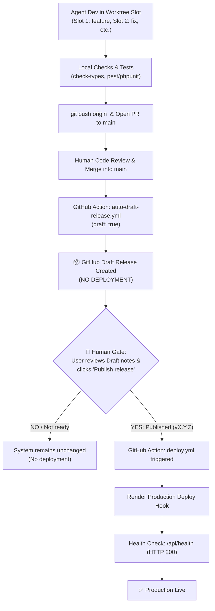

# AGENTS.md - AI Operating Manual & Invariants

> [!IMPORTANT]
> **MANDATORY RULES FOR ALL AI AGENTS**: Adhere to worktree slot isolation, strict PR review gates, Draft Release lifecycle, and the **Mandatory Human Approval Gate for Production Deployment (Deploy ONLY when a new release is published)**.

---

## 1. Worktree Protocol & Dedicated Role Matrix
The root workspace is an **idle anchor** strictly tracking `main`. All dev, commits, testing, and branch switches **MUST** occur inside persistent worktree slots managed by `.\scripts\agent-worktree.ps1`.

### Dedicated Worktree Slot Matrix for AI Agents
| Slot | Dedicated Role | Allowed Branch Prefixes | Port Mapping | Purpose & Scope |
| :---: | :--- | :--- | :--- | :--- |
| **1** | `feature` | `feature/*` | Laravel: 8010<br>Vite: 5181 | **New Features & Capabilities**: Ingest workflows, UI screens, crawler workers. |
| **2** | `fix` | `fix/*` | Laravel: 8020<br>Vite: 5182 | **Bug Fixes & Defect Repairs**: Issue resolution, null checks, query optimization. |
| **3** | `hotfix` | `hotfix/*` | Laravel: 8030<br>Vite: 5183 | **Critical Production Patches**: Emergency security fixes, hot patches for live services. |
| **4** | `refactor` / `test` | `refactor/*`, `test/*` | Laravel: 8040<br>Vite: 5184 | **Refactoring & Test Automation**: Code cleanup, modularization, Pest/PHPUnit & Vitest. |
| **5** | `release` / `docs` | `release/*`, `chore/*`, `docs/*`, `ci/*` | Laravel: 8050<br>Vite: 5185 | **Release Packaging & Maintenance**: SemVer bumping, changelog, documentation, CI workflows. |

### Worktree CLI Commands for Agent
```powershell
# 1. Inspect all slots, roles, and status
.\scripts\agent-worktree.ps1 -Action List

# 2. Switch to a dedicated slot by Role and create branch
.\scripts\agent-worktree.ps1 -Role feature -Branch "feature/TIK-101-profile-sync" -CreateBranch
.\scripts\agent-worktree.ps1 -Role fix -Branch "fix/TIK-102-null-author" -CreateBranch
.\scripts\agent-worktree.ps1 -Role hotfix -Branch "hotfix/SEC-001-api-key" -CreateBranch
.\scripts\agent-worktree.ps1 -Role refactor -Branch "refactor/clean-routes" -CreateBranch
.\scripts\agent-worktree.ps1 -Role release -Branch "release/v1.1.0" -CreateBranch

# 3. Inspect status across all worktrees
.\scripts\agent-worktree.ps1 -Action Status

# 4. Clean and reset a slot to idle state after PR merge
.\scripts\agent-worktree.ps1 -Action Clean -Slot 1
```

---

## 2. Strict PR Gate (ZERO Direct Push to `main`)
1. **Agent MUST NEVER push directly to `main`**. Working or committing directly on `main` is strictly prohibited.
2. Push branch to remote origin:
   ```powershell
   git -C "<worktree-path>" push -u origin <branch>
   ```
3. Prepare and output Pull Request targeting `main`:
   ```powershell
   .\scripts\agent-pr.ps1 -Role feature -Branch "feature/TIK-101-profile-sync"
   ```
4. **🛑 AGENT STOPS**: Hand over the PR link to the human User. **Only the human User reviews and merges the PR into `main`**.

---

## 3. Release Lifecycle & Controlled Deployment Gate



### Invariants for Production Deployment:
1. **Deploy CHỈ KHI NÀO release bản mới**:
   - Pushing code or merging PRs into `main` **NEVER** deploys to production.
   - Merging into `main` ONLY triggers `.github/workflows/auto-draft-release.yml`, generating a **GitHub Draft Release** (`draft: true`).
2. **🛑 MANDATORY HUMAN RELEASE GATE**:
   - **Agent is STRICTLY FORBIDDEN from publishing a release or triggering production deployment**.
   - Only the human User opens GitHub Releases, reviews notes and assets, and clicks **"Publish release"** (or pushes tag `v*.*.*`).
   - Publication triggers `.github/workflows/deploy.yml` which executes Render deploy hooks and validates `/api/health`.

---

## 4. Code Standards & Reusability Matrix
- **Language**: English-only for all text, comments, docstrings, commits, and PR descriptions.
- **Commits**: Strict Conventional Commits (`feat(scope): ...`, `fix(scope): ...`, `chore(release): ...`).
- **TypeScript**: 100% Strict TypeScript. `npm.cmd run check-types` (0 compilation errors). React 19. No untyped `any`.
- **PowerShell**: On Windows, invoke tools via `npm.cmd` / `npx.cmd`.
- **Mandatory Documentation Update**:
  - Update `README.md`: Document new capabilities, commands, or workflows.
  - Update `PROJECT_SUMMARY.md`: Append a milestone entry detailing the solution, touched files, and test results before reporting completion.

### Core Reusability Matrix (DO NOT REINVENT)
| Layer | Core Asset | Usage Standard |
| :--- | :--- | :--- |
| **Listings** | `@core/components/ListLayout` | **Mandatory** for entity listing pages. No custom wrapper divs. |
| **Tables** | `@core/components/Table` | **Mandatory**. Use native `onEdit`, `onDelete`, `extraActions`. |
| **Actions** | `@core/hooks/useAction` | **Mandatory** for row actions (delete, toggle). Handles toast/loading. |
| **Forms/Modals** | `@core/components/ResourceForm`, `CustomModal` | Standard form controls and modal dialogs. |
| **KPI/Tags** | `@core/components/CardKPI`, `StatusTag`, `NumericRangeFilter` | Standard dashboard and metric cards. |
| **RBAC** | `@core/components/PermissionGate`, `usePermission` | Permission gates: `<PermissionGate module="x" action="y">`. |
| **State** | Redux (`store/<domain>/`) | All entity lists, filters, pagination MUST use Redux. |
| **Backend** | `BaseController`, `BaseRepository` | Thin controllers and repos strictly extending Base. Zero redundant overrides. |
