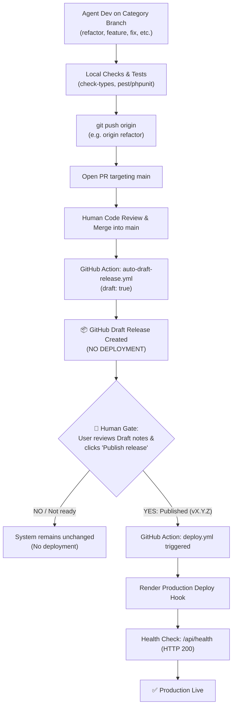

# AGENTS.md - AI Operating Manual & Invariants

> [!IMPORTANT]
> **MANDATORY RULES FOR ALL AI AGENTS**:
> 1. **STRICTLY FORBIDDEN TO PUSH DIRECTLY TO `main`**: AI agents must NEVER run `git push origin main` or commit directly on `main`.
> 2. **Fixed Category Branch Policy**: Do NOT create dynamic branch names like `feature/<description>` or `refactor/<description>`. Push strictly to the matching fixed category branch (`feature`, `fix`, `refactor`, `hotfix`, `test`, `chore`).
> 3. **Draft Release & Production Gate**: Merging to `main` creates a Draft Release. Deploy to production ONLY when the human user publishes the release.

---

## 1. Fixed Category Branch Workflow

To keep the repository clean and avoid branch sprawl, we use **fixed, persistent category branches** matching the task type (no sub-branch suffixes):

| Branch Name | Type | Scope & Purpose |
| :--- | :--- | :--- |
| **`feature`** | Feature | New features & capabilities: Ingest workflows, UI screens, crawler workers. |
| **`fix`** | Bug Fix | Defect repairs: Bug resolution, null checks, query optimization. |
| **`refactor`** | Refactoring | Code cleanup, modularization, directory restructuring, centralizing assets. |
| **`hotfix`** | Hotfix | Critical production patches: Emergency fixes for live services. |
| **`test`** | Testing | Test automation: Pest/PHPUnit, Vitest. |
| **`chore`** | Maintenance | Dependencies, CI workflows, documentation, release preparation. |

### Standard Git Commands for Agent
```powershell
# 1. Checkout the matching category branch (e.g., refactor, feature, or fix)
git checkout refactor
# Sync with latest main if needed
git merge main

# 2. Develop and run validation checks
npm.cmd run check-types
php artisan test

# 3. Commit with Conventional Commits
git add .
git commit -m "refactor(crawler): centralize documentation and agent skills"

# 4. Push directly to the matching category branch (NEVER push to main!)
git push -u origin refactor
```

---

## 2. Pull Request & Merging Standard
1. **Agent MUST NEVER push directly to `main`**.
2. Push exclusively to the active category branch:
   ```powershell
   git push -u origin <category-branch>
   ```
   *(e.g., `git push -u origin refactor` or `git push -u origin feature`)*
3. Hand over the GitHub Pull Request URL targeting `main` to the human user.
4. **Only the human User reviews and merges the PR into `main`**.

---

## 3. Release Lifecycle & Controlled Deployment Gate



### Invariants for Production Deployment:
1. **Deploy CHỈ KHI NÀO release bản mới**:
   - Pushing code or merging PRs into `main` **NEVER** deploys to production.
   - Merging into `main` ONLY triggers `.github/workflows/auto-draft-release.yml`, generating a **GitHub Draft Release** (`draft: true`).
2. **🛑 MANDATORY HUMAN RELEASE GATE**:
   - **Agent is STRICTLY FORBIDDEN from publishing a release or triggering production deployment**.
   - Only the human User opens GitHub Releases, reviews notes and assets, and clicks **"Publish release"** (or pushes tag `v*.*.*`).
   - Publication triggers `.github/workflows/deploy.yml` which executes Render deploy hooks and validates `/api/health`.

---

## 4. Code Standards & Reusability Matrix
- **Language**: English-only for all text, comments, docstrings, commits, and PR descriptions.
- **Commits**: Strict Conventional Commits (`feat(scope): ...`, `fix(scope): ...`, `chore(release): ...`, `refactor(scope): ...`).
- **TypeScript**: 100% Strict TypeScript. `npm.cmd run check-types` (0 compilation errors). React 19. No untyped `any`.
- **PowerShell**: On Windows, invoke tools via `npm.cmd` / `npx.cmd`.
- **Documentation Update**:
  - Update `PROJECT_SUMMARY.md`: Append a milestone entry detailing the solution, touched files, and test results before reporting completion.

### Core Reusability Matrix (DO NOT REINVENT)
| Layer | Core Asset | Usage Standard |
| :--- | :--- | :--- |
| **Listings** | `@core/components/ListLayout` | **Mandatory** for entity listing pages. No custom wrapper divs. |
| **Tables** | `@core/components/Table` | **Mandatory**. Use native `onEdit`, `onDelete`, `extraActions`. |
| **Actions** | `@core/hooks/useAction` | **Mandatory** for row actions (delete, toggle). Handles toast/loading. |
| **Forms/Modals** | `@core/components/ResourceForm`, `CustomModal` | Standard form controls and modal dialogs. |
| **KPI/Tags** | `@core/components/CardKPI`, `StatusTag`, `NumericRangeFilter` | Standard dashboard and metric cards. |
| **RBAC** | `@core/components/PermissionGate`, `usePermission` | Permission gates: `<PermissionGate module="x" action="y">`. |
| **State** | Redux (`store/<domain>/`) | All entity lists, filters, pagination MUST use Redux. |
| **Backend** | `BaseController`, `BaseRepository` | Thin controllers and repos strictly extending Base. Zero redundant overrides. |
