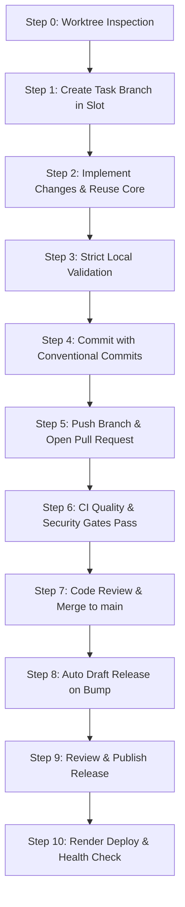

# AGENTS.md - AI Agent Operating Manual & Repository Infrastructure Guidelines

> [!IMPORTANT]
> **MANDATORY READING FOR ALL AI AGENTS BEFORE EXECUTING ANY TASK!**
> Adhere strictly to the Worktree protocol, English-only standard, Core reusability matrix (DO NOT REINVENT), Pull Request review gates, Draft Release lifecycle, and Render deployment security rules.

---

## 1. Non-Negotiable Core Invariants

1. **Step 0 - Worktree-Exclusive Protocol**: Run `.\scripts\agent-worktree.ps1 -Action List` or `git worktree list` first. The root repository (`E:\Urekamedia\project1`) is strictly an idle anchor. All development, commits, tests, and branch switches MUST occur inside persistent worktree slots (`project1-worktree-1` to `project1-worktree-5`).
2. **Standardized Branch Naming**: Branches MUST follow the standard convention:
   - `feature/<task-id>-<description>`
   - `fix/<task-id>-<description>`
   - `hotfix/<task-id>-<description>`
   - `refactor/<task-id>-<description>`
   - `test/<task-id>-<description>`
   - `docs/<task-id>-<description>`
   - `chore/<task-id>-<description>`
   - `ci/<task-id>-<description>`
3. **No Direct Push to Protected Branches**: Agents and developers MUST NEVER push directly to `main` or `develop`. All integration requires opening a Pull Request with passing CI gates and human review approval.
4. **Strict English Requirement**: All UI text (button labels, headers, placeholders, toasts, errors), code comments, docstrings, variable names, PR descriptions, and commit messages MUST be in English.
5. **100% Strict TypeScript**: React 19 + TypeScript. No untyped `any`. Run `npm.cmd run check-types` with 0 compilation errors.
6. **Windows PowerShell Execution**: Always invoke `npm.cmd` or `npx.cmd` in PowerShell to prevent permission blocks.
7. **Direct Imports Only (No Barrel Files)**: Never create barrel re-export `index.ts` files (`components/index.ts`, `hooks/index.ts`). Always use direct imports: `import ListLayout from '@core/components/ListLayout'`.
8. **Draft Release Lifecycle & Semantic Versioning**:
   - Version bumps follow Semantic Versioning (MAJOR.MINOR.PATCH) in `cms-tiktok-crawler/package.json`.
   - Merging a version bump into `main` automatically triggers GitHub Action `auto-draft-release.yml` to package artifacts and create a **Draft Release**.
   - A **Draft Release NEVER deploys to production**. Production deployment requires an explicit review and publication.
9. **Controlled Render Production Deployment**:
   - Production deployment is triggered ONLY when a release is explicitly published (`release: types: [published]`) or via authorized manual workflow dispatch.
   - Deployments execute automated post-deployment health checks against `https://cms-tiktok-web.onrender.com/api/health` and verify the commit SHA.
   - If health checks fail, the deployment is marked FAILED and rollback guidance is emitted.
10. **Security & Secrets**: Never commit `.env`, credentials, API tokens, or secrets. Never disable security checks.
11. **Mandatory `PROJECT_SUMMARY.md` Update**: Append a new milestone entry in [`PROJECT_SUMMARY.md`](PROJECT_SUMMARY.md) summarizing the technical solution, touched files, and test results before reporting completion.

---

## 2. Core Reusability Matrix (DO NOT REINVENT — REUSE EXISTING ASSETS!)

> [!CAUTION]
> **STOP AND INSPECT BEFORE CODING!**
> Never write custom listing wrappers, table action columns, manual API loading try-catches, or redundant repository methods. **Always reuse these Core assets:**

| Domain / Layer | Asset & Import Path | Mandatory Usage Standard |
| :--- | :--- | :--- |
| **Listing Pages** | [`ListLayout`](modules/Core/resources/js/components/ListLayout.tsx)<br>`@core/components/ListLayout` | **MANDATORY** for all entity list pages. Encapsulates header, search, filter slots, create button, and table embedding. Do NOT create custom wrapper divs. |
| **Tables & Actions** | [`TableComponent`](modules/Core/resources/js/components/Table.tsx)<br>`@core/components/Table` | **MANDATORY**. Always use native action props: `onEdit`, `onDelete`, `canDelete`, `extraActions`. Do NOT write manual `actionColumns` with Popconfirm/Tooltip boilerplate. |
| **Async API Actions** | [`useAction`](modules/Core/resources/js/hooks/useAction.ts)<br>`@core/hooks/useAction` | **MANDATORY** for single/row actions (delete, toggle status, trigger). Automatically handles loading state, toasts (`message.success`/`error`), and reload callbacks. Do NOT write manual `try/catch` with `useState(loading)`. |
| **Create/Edit Forms** | [`ResourceForm`](modules/Core/resources/js/components/ResourceForm.tsx)<br>[`CustomModal`](modules/Core/resources/js/components/CustomModal.tsx) | Standardized form controls and modal dialogs. |
| **KPI & UI Metrics** | [`CardKPI`](modules/Core/resources/js/components/CardKPI.tsx)<br>[`StatusTag`](modules/Core/resources/js/components/StatusTag.tsx)<br>[`NumericRangeFilter`](modules/Core/resources/js/components/NumericRangeFilter.tsx) | Metric cards, status pills, and min/max numeric range filters. |
| **RBAC / Authorization** | [`PermissionGate`](modules/Core/resources/js/components/PermissionGate.tsx)<br>[`usePermission`](modules/Core/resources/js/hooks/usePermission.ts) | UI permission checks: `<PermissionGate module="user" action="delete">` or `const { can } = usePermission()`. |
| **State Management** | Redux Slice & Thunks | Entity lists, filters, pagination, and modal state MUST use Redux (`store/<domain>/`). NEVER clutter pages with 5+ local `useState` hooks. |
| **Backend Controllers** | [`BaseController`](modules/Core/src/Http/Controllers/BaseController.php)<br>`src/Http/Controllers/` | **MUST extend** `BaseController`. Declare `$modelClass`, `$resourceClass`, `$searchableColumns`, `$filterableColumns`. Thin controllers only. |
| **Form Requests** | `src/Http/Requests/` | Isolate input validation rules into dedicated Form Request classes. |
| **Custom Middleware** | `src/Http/Middleware/` | Custom HTTP middleware (e.g. [`CheckModulePermission`](modules/Core/src/Http/Middleware/CheckModulePermission.php)). |
| **Backend Repositories** | [`BaseRepository`](modules/Core/src/Repositories/BaseRepository.php)<br>`src/Repositories/` | **MUST extend** `BaseRepository`. Query strictly via `$this->model` (`$this->model->where(...)`). **ZERO redundant overrides** of base methods (`findById`, `all`, `create`, `update`, `delete`). |

---

## 3. Step-by-Step AI Agent Execution Protocol



1. **Step 0 - Select Worktree Slot**:
   ```powershell
   .\scripts\agent-worktree.ps1 -Action List
   .\scripts\agent-worktree.ps1 -WorktreeIndex 1 -Branch "feature/PROJ-101-proxy-rotation" -CreateBranch
   ```
2. **Step 1 - Navigate to Worktree Module Workspace**:
   ```powershell
   cd E:\Urekamedia\project1-worktree-1\cms-tiktok-crawler
   ```
3. **Step 2 - Development**:
   Follow Core Reusability Matrix and architectural guidelines. Keep English UI and comments only.
4. **Step 3 - Local Validation**:
   ```powershell
   npm.cmd run check-types               # 0 TypeScript compilation errors
   php artisan test                      # 100% backend tests passing
   ```
5. **Step 4 - Conventional Commit**:
   ```powershell
   git commit -m "feat(crawler): implement exponential backoff proxy rotation"
   ```
6. **Step 5 - Push Branch & Open Pull Request**:
   ```powershell
   git push -u origin feature/PROJ-101-proxy-rotation
   ```
   Open PR targeting `main` using `.github/pull_request_template.md`.
7. **Step 6 - Cleanup & Reset Worktree After Merge**:
   ```powershell
   cd E:\Urekamedia\project1
   .\scripts\agent-worktree.ps1 -Action Clean -WorktreeIndex 1
   ```

---

## 4. Documentation References

- **Git Worktree Workflow**: [`docs/development/git-worktree-workflow.md`](docs/development/git-worktree-workflow.md)
- **CI/CD Pipeline Architecture**: [`docs/deployment/ci-cd-architecture.md`](docs/deployment/ci-cd-architecture.md)
- **Release Management & SemVer**: [`docs/deployment/release-management.md`](docs/deployment/release-management.md)
- **Render Production Deployment**: [`docs/deployment/render-deployment.md`](docs/deployment/render-deployment.md)
- **Core Module Guide**: [`docs/CORE_MODULE_GUIDE.md`](docs/CORE_MODULE_GUIDE.md)
- **Testing Guide**: [`docs/TESTING_GUIDE.md`](docs/TESTING_GUIDE.md)
