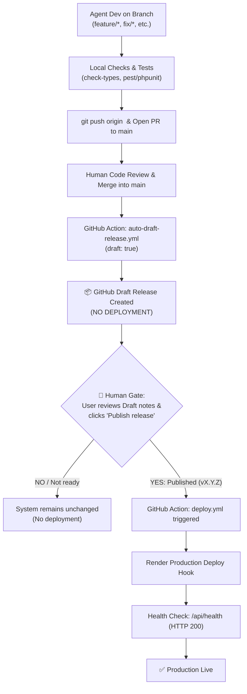

# AGENTS.md - AI Operating Manual & Invariants

> [!IMPORTANT]
> **MANDATORY RULES FOR ALL AI AGENTS**: Direct branch workflow, strict Conventional Commits, clean TypeScript and backend test validations, Draft Release lifecycle, and the **Mandatory Human Approval Gate for Production Deployment (Deploy ONLY when a new release is published)**.

---

## 1. Branch Workflow (Direct Branch Protocol)
Work directly in the project workspace on dedicated task branches. Worktree isolation is disabled.

### Branch Naming Conventions
> [!IMPORTANT]
> **Single Branch Policy (No Description Sub-branches)**:
> When fixing bugs, agents MUST NOT append descriptions to the branch (e.g. do NOT create `fix/<description>` or `fix/TIK-...`).
> Always checkout and push directly to branch `fix` (or `feature`, `refactor`) to prevent repository branch sprawl:
> `git checkout fix` (or `git checkout -B fix origin/main`).
| Prefix | Type | Purpose & Scope |
| :--- | :--- | :--- |
| `feature` | Feature | New features & capabilities: Ingest workflows, UI screens, crawler workers. |
| `fix` | Bug Fix | Defect repairs: Issue resolution, null checks, query optimization. Use **strictly `fix`** directly (do NOT append `/<description>` or `/<ticket>` to avoid branch proliferation). |
| `hotfix` | Hotfix | Critical production patches: Emergency fixes for live services. |
| `refactor` | Refactoring | Code cleanup, modularization, structure improvements. |
| `test` | Testing | Test automation: Pest/PHPUnit, Vitest. |
| `release/*`, `chore` | Release/Maintenance | SemVer bumping, changelog, dependencies, CI workflows. |

### Standard Git Commands for Agent
```powershell
# 1. Ensure latest main and switch to task branch (e.g. 'fix')
git checkout main
git pull origin main
git checkout -B fix origin/main

# 2. Develop and run validation checks
npm.cmd run check-types
php artisan test

# 3. Commit with Conventional Commits
git add .
git commit -m "fix(crawler): add error retry exponential backoff"

# 4. Push branch to remote
git push -u origin fix
```

---

## 2. Pull Request & Merging Standard
1. **Agent MUST NOT push unreviewed breaking changes directly to `main`**. Always work on task branches.
2. Push branch to remote origin:
   ```powershell
   git push -u origin <branch>
   ```
3. Create Pull Request targeting `main`.
4. Hand over the PR link to the human User, or merge after all CI/local validations pass if instructed.

---

## 3. Release Lifecycle & Controlled Deployment Gate



### Invariants for Production Deployment:
1. **Deploy CHỈ KHI NÀO release bản mới**:
   - Pushing code or merging PRs into `main` **NEVER** deploys to production.
   - Merging into `main` ONLY triggers `.github/workflows/auto-draft-release.yml`, generating a **GitHub Draft Release** (`draft: true`).
2. **🛑 MANDATORY HUMAN RELEASE GATE**:
   - **Agent is STRICTLY FORBIDDEN from publishing a release or triggering production deployment**.
   - Only the human User opens GitHub Releases, reviews notes and assets, and clicks **"Publish release"** (or pushes tag `v*.*.*`).
   - Publication triggers `.github/workflows/deploy.yml` which executes Render deploy hooks and validates `/api/health`.

---

## 4. Code Standards & Reusability Matrix
- **Language**: English-only for all text, comments, docstrings, commits, and PR descriptions.
- **Commits**: Strict Conventional Commits (`feat(scope): ...`, `fix(scope): ...`, `chore(release): ...`).
- **TypeScript**: 100% Strict TypeScript. `npm.cmd run check-types` (0 compilation errors). React 19. No untyped `any`.
- **PowerShell**: On Windows, invoke tools via `npm.cmd` / `npx.cmd`.
- **Documentation Update**:
  - Update `PROJECT_SUMMARY.md`: Append a milestone entry detailing the solution, touched files, and test results when completing significant features.

### Core Reusability Matrix (DO NOT REINVENT)
| Layer | Core Asset | Usage Standard |
| :--- | :--- | :--- |
| **Listings** | `@core/components/ListLayout` | **Mandatory** for entity listing pages. No custom wrapper divs. |
| **Tables** | `@core/components/Table` | **Mandatory**. Use native `onEdit`, `onDelete`, `extraActions`. |
| **Actions** | `@core/hooks/useAction` | **Mandatory** for row actions (delete, toggle). Handles toast/loading. |
| **Forms/Modals** | `@core/components/ResourceForm`, `CustomModal` | Standard form controls and modal dialogs. |
| **KPI/Tags** | `@core/components/CardKPI`, `StatusTag`, `NumericRangeFilter` | Standard dashboard and metric cards. |
| **RBAC** | `@core/components/PermissionGate`, `usePermission` | Permission gates: `<PermissionGate module="x" action="y">`. |
| **State** | Redux (`store/<domain>/`) | All entity lists, filters, pagination MUST use Redux. |
| **Backend** | `BaseController`, `BaseRepository` | Thin controllers and repos strictly extending Base. Zero redundant overrides. |
