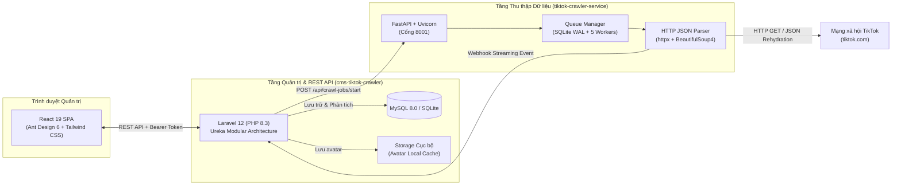

# CMS TikTok Crawler Platform

> **Nền tảng doanh nghiệp thu thập dữ liệu TikTok phân tán, quản lý hồ sơ tài khoản, video, phân tích chỉ số KPI và phân quyền quản trị chuyên sâu.**

Dự án được xây dựng theo mô hình **Monorepo** chuẩn kiến trúc doanh nghiệp **Ureka Modular Architecture**, kết hợp giữa cổng quản trị **Laravel 12 + React 19 SPA (Ant Design 6 & Tailwind CSS 4)** và microservice thu thập dữ liệu hiệu năng cao **Python 3.10+ (FastAPI + AsyncIO + SQLite WAL Queue)**.

---

## 📑 Mục lục
1. [Tổng quan Kiến trúc & Công nghệ](#-tổng-quan-kiến-trúc--công-nghệ)
2. [Cấu trúc Thư mục Monorepo](#-cấu-trúc-thư-mục-monorepo)
3. [Tính năng Nổi bật](#-tính-năng-nổi-bật)
4. [Yêu cầu Môi trường](#-yêu-cầu-môi-trường)
5. [Hướng dẫn Cài đặt & Khởi chạy Chi tiết](#-hướng-dẫn-cài-đặt--khởi-chạy-chi-tiết)
   - [1. Thiết lập Backend & Frontend CMS (`cms-tiktok-crawler`)](#1-thiết-lập-backend--frontend-cms-cms-tiktok-crawler)
   - [2. Thiết lập Microservice Python Crawler (`tiktok-crawler-service`)](#2-thiết-lập-microservice-python-crawler-tiktok-crawler-service)
   - [3. Truy cập Hệ thống & Tài khoản Mặc định](#3-truy-cập-hệ-thống--tài-khoản-mặc-định)
6. [Kiểm thử & Đảm bảo Chất lượng](#-kiểm-thử--đảm-bảo-chất-lượng)
7. [Triển khai Production & Docker](#-triển-khai-production--docker)
8. [Quy chuẩn Phát triển & Đóng góp](#-quy-chuẩn-phát-triển--đóng-góp)

---

## 🏗️ Tổng quan Kiến trúc & Công nghệ

Hệ thống được chia tách rành mạch thành 2 tầng dịch vụ độc lập giao tiếp qua RESTful Webhook:



### Bảng Công nghệ Cốt lõi:
| Thành phần | Công nghệ chính | Vai trò & Đặc điểm |
| :--- | :--- | :--- |
| **Backend CMS** | Laravel 12, PHP 8.3, Composer | Kiến trúc 3 tầng nghiêm ngặt (Controller -> Service -> Repository), Dynamic Route Resolver, Sanctum API Token. |
| **Frontend Portal** | React 19, TypeScript, Ant Design 6, Redux Toolkit, Tailwind CSS 4 | Giao diện Single Page Application (SPA), 100% Strict Type, hỗ trợ Path Aliases (`@core`, `@crawler`, `@auth`...). |
| **Crawler Engine** | Python 3.10+, FastAPI, AsyncIO, SQLite WAL, httpx, BeautifulSoup4 | Bóc tách trực tiếp JSON nhúng (`__UNIVERSAL_DATA_FOR_REHYDRATION__`), siêu nhẹ RAM (50–80MB), Rate Limiter & Circuit Breaker. |
| **Cơ sở dữ liệu** | MySQL 8.0+ / SQLite, Redis | Lưu trữ tài khoản, lịch sử crawl, logs, và quản lý hàng đợi Laravel. |
| **Môi trường & Deploy** | Docker, Nginx, PHP-FPM, Render Blueprint (`render.yaml`) | Đóng gói container hoàn chỉnh với Health Probe tự động `/api/health`. |

---

## 📂 Cấu trúc Thư mục Monorepo

```text
TIKTOK-CRAWLER/
├── .agents/                               # AI Assistant Skills & runbooks chuẩn hóa quy trình
├── cms-tiktok-crawler/                    # ỨNG DỤNG CHÍNH: LARAVEL 12 & REACT 19 SPA
│   ├── app/                               # Khung mặc định Laravel
│   ├── config/                            # Cấu hình framework
│   ├── database/                          # Seeders hệ thống (DatabaseSeeder.php)
│   ├── modules/                           # CÁC MODULE NGHIỆP VỤ (Ureka Modular Layer)
│   │   ├── Core/                          # Hạ tầng dùng chung, BaseController, UI Widgets, Scoped DOM
│   │   ├── Crawler/                       # Quản lý phiên crawl, bảng kết quả, cấu hình bộ cào
│   │   ├── TiktokAccount/                 # Hồ sơ TikTok, video, thống kê tương tác
│   │   ├── Auth/                          # Đăng nhập, cấp phát Sanctum Token, Reset mật khẩu
│   │   ├── User/                          # Quản lý tài khoản quản trị viên và người dùng
│   │   ├── Role/ & Permission/            # Ma trận phân quyền RBAC đa cấp bậc
│   │   ├── System/                        # Nhật ký thao tác (Audit Logs), System Settings
│   │   └── API/                           # Webhook tiếp nhận kết quả từ Python Crawler
│   ├── public/                            # Điểm phát hành tĩnh, entrypoints.json, avatar storage
│   ├── routes/                            # Route định tuyến
│   ├── vite.config.ts                     # Cấu hình Vite & Path Aliases
│   └── package.json                       # Dependencies frontend React 19 & Ant Design
├── tiktok-crawler-service/                # MICROSERVICE PYTHON CRAWLER ĐỘC LẬP
│   ├── app/
│   │   ├── api/                           # FastAPI endpoints (/api/crawl-jobs/start, /health)
│   │   ├── core/                          # Quản lý config (.env) & utils
│   │   ├── crawler/                       # HTTP Client, Rate Limiter, Circuit Breaker, trích xuất JSON
│   │   ├── engine/                        # Hàng đợi SQLite WAL, Pool 5 Workers, Crash Recovery
│   │   ├── schemas/                       # Pydantic data schemas
│   │   └── services/                      # Xử lý datasets và webhook đẩy về Laravel
│   ├── datasets/                          # Thư mục chứa các tệp CSV/TXT dữ liệu cho chế độ 'count'
│   ├── data/                              # Tự động sinh: chứa queue.db (SQLite WAL)
│   ├── tests/                             # Bộ 18 automated unit & integration tests
│   ├── requirements.txt                   # Danh sách thư viện Python
│   └── .env.example                       # File mẫu biến môi trường của crawler
├── docker/                                # Dockerfile.web, Dockerfile.crawler, Dockerfile.worker, Nginx
├── docs/                                  # Toàn bộ tài liệu kiến trúc & hướng dẫn kỹ thuật chi tiết
├── scripts/                               # Bộ PowerShell scripts kiểm định chất lượng (verify-workflow.ps1)
└── render.yaml                            # Blueprint triển khai tự động lên Render.com
```

---

## 🌟 Tính năng Nổi bật

### 1. Cơ chế Crawl Linh hoạt & Đa chế độ
- **3 Chế độ nguồn dữ liệu (Source Type)**:
  - `usernames`: Nhập danh sách username TikTok tùy ý (hỗ trợ nhập hàng loạt qua textarea).
  - `urls`: Dán trực tiếp danh sách URL profile hoặc URL video TikTok; hệ thống tự động chuẩn hóa.
  - `count`: Tự động đọc dữ liệu từ các file CSV/TXT trong thư mục `datasets/`, lọc trùng lặp và lấy ngẫu nhiên số lượng chỉ định.
- **3 Chế độ thu thập (Crawl Mode)**:
  - `account_only`: Thu thập toàn bộ chỉ số tài khoản (Followers, Following, Likes, Bio, Verified).
  - `account_with_videos`: Thu thập thông tin kênh kết hợp trích xuất danh sách video mới nhất.
  - `video_only`: Chỉ bóc tách thông tin chi tiết của danh sách video được cung cấp.
- **Tùy chỉnh số lượng video mỗi kênh**: Bộ preset cấu hình sẵn (`10 Video`, `20 Video - Tiêu chuẩn`, `50 Video`, `100 Video`).

### 2. Động cơ Python Crawler Siêu nhẹ & Chống chặn
- **Tiêu thụ tài nguyên tối thiểu**: Sử dụng cơ chế phân tích HTTP JSON tĩnh từ trang HTML TikTok; không khởi chạy trình duyệt nặng (Chromium/Puppeteer), tiết kiệm 95% RAM (chỉ tốn ~50–80MB).
- **Hàng đợi chống nghẽn (SQLite WAL)**: Cho phép hàng trăm người dùng bấm Start cùng lúc mà không bị rớt job; trả phản hồi `202 Accepted` tức thì.
- **Fixed Worker Pool (5 Luồng)**: Điều phối công việc tuần tự, bảo vệ IP máy chủ không bị TikTok đưa vào blacklist.
- **Bộ ngắt mạch thông minh (Circuit Breaker)**: Tự động phát hiện khi TikTok phản hồi mã lỗi `429 Too Many Requests` hoặc `Challenge` để tạm dừng toàn bộ worker trong thời gian chờ hồi phục.
- **Streaming Webhook Realtime**: Gửi kết quả về CMS ngay khi cào xong từng tài khoản; người dùng theo dõi tiến độ trên giao diện mà không cần chờ toàn bộ job kết thúc.
- **Tự động lưu Avatar về Local**: Tải ảnh đại diện, kiểm tra magic bytes chuẩn (`JPEG/PNG/WEBP`), gửi base64 về Laravel CMS lưu vào `public/tiktok-accounts/avatars/` và lưu đường dẫn nội bộ (bảo đảm avatar hiển thị ổn định, không bị chặn hotlink bởi TikTok CDN).
- **Khôi phục sau sự cố 2 tầng (Crash Recovery)**: Tự động khôi phục lại các job đang chạy dở dang khi service khởi động lại hoặc sau khi redeploy container.

### 3. Cổng Quản trị Doanh nghiệp Hiện đại (CMS SPA)
- **Dashboard Phân tích Tổng thể**: Thống kê số lượng kênh, tổng lượt theo dõi, tổng tương tác like, biểu đồ tăng trưởng và trạng thái các job crawl theo thời gian thực.
- **Phân quyền RBAC Ma trận**: Thiết lập chi tiết quyền Xem/Sửa/Xóa theo từng module cho 4 cấp bậc tài khoản: `admin`, `manager`, `editor`, `viewer`.
- **Nhật ký Hệ thống (Audit Logs)**: Ghi vết toàn bộ hành động tạo job, cập nhật tài khoản, phân quyền và lịch sử đăng nhập.
- **Giao diện Responsive**: Được tối ưu trên nền Ant Design 6 và Tailwind CSS 4, hỗ trợ bộ lọc đa năng `NumericRangeFilter`, popup chi tiết và bảng dữ liệu chuyên nghiệp.

---

## 💻 Yêu cầu Môi trường

Trước khi cài đặt, hãy đảm bảo máy chủ/máy trạm của bạn đã cài đặt các công cụ sau:

- **PHP** >= `8.3` (các extensions bắt buộc: `pdo_mysql`, `mbstring`, `bcmath`, `zip`, `intl`, `gd`, `fileinfo`, `curl`)
- **Composer** >= `2.6`
- **Node.js** >= `20.x` & **NPM** >= `10.x`
- **Python** >= `3.10` & **Pip**
- **Cơ sở dữ liệu**: MySQL `>= 8.0` (khuyên dùng) hoặc SQLite
- **Hệ điều hành**: Linux, macOS hoặc Windows (PowerShell)

---

## 🚀 Hướng dẫn Cài đặt & Khởi chạy Chi tiết

Thực hiện lần lượt các bước dưới đây để chạy toàn bộ hệ thống từ mã nguồn:

### 1. Thiết lập Backend & Frontend CMS (`cms-tiktok-crawler`)

Mở terminal tại thư mục gốc của dự án:

```bash
# Di chuyển vào thư mục CMS
cd cms-tiktok-crawler

# Sao chép file cấu hình môi trường
cp .env.example .env
```

Mở tệp `.env` vừa tạo và cập nhật các thông số cơ sở dữ liệu:
```ini
APP_NAME="CMS Tiktok Crawler"
APP_ENV=local
APP_KEY=
APP_DEBUG=true
APP_URL=http://localhost:8000

# Cấu hình Cơ sở dữ liệu (Ví dụ MySQL)
DB_CONNECTION=mysql
DB_HOST=127.0.0.1
DB_PORT=3306
DB_DATABASE=cms_tiktok_crawler
DB_USERNAME=root
DB_PASSWORD=your_password

# Cấu hình kết nối tới Python Crawler Service
CRAWLER_SERVICE_URL=http://localhost:8001
```

Tiếp theo, cài đặt dependencies và khởi tạo cơ sở dữ liệu:

```bash
# 1. Cài đặt các thư viện PHP qua Composer
composer install

# 2. Khởi tạo khóa mã hóa ứng dụng
php artisan key:generate

# 3. Tạo symlink liên kết thư mục lưu trữ avatar ra thư mục public
php artisan storage:link

# 4. Chạy migration và nạp dữ liệu mẫu ban đầu (Users, Roles, Permissions)
php artisan migrate --seed

# 5. Cài đặt các gói thư viện Frontend (React 19, Antd, Tailwind)
npm install
```

Khởi chạy đồng thời Backend và Frontend:
```bash
# Terminal 1: Chạy máy chủ Laravel Backend (Cổng 8000)
php artisan serve

# Terminal 2: Chạy Vite Frontend Dev Server với tính năng HMR (Cổng 5173)
npm run dev
```

> **Ghi chú khi đóng gói Production**: Chạy lệnh `npm run build` hoặc `npm run mix:all` để biên dịch toàn bộ asset giao diện vào `public/entrypoints.json`.

---

### 2. Thiết lập Microservice Python Crawler (`tiktok-crawler-service`)

Mở một cửa sổ terminal mới từ thư mục gốc dự án:

```bash
# Di chuyển vào thư mục microservice
cd tiktok-crawler-service

# Tạo môi trường ảo Python (khuyên dùng)
python -m venv venv

# Kích hoạt môi trường ảo
# Trên Linux/macOS:
source venv/bin/activate
# Trên Windows (PowerShell):
.\venv\Scripts\Activate.ps1

# Cài đặt các thư viện Python cần thiết
pip install -r requirements.txt

# Sao chép cấu hình môi trường
cp .env.example .env
```

Kiểm tra nội dung tệp `.env` của crawler:
```ini
CRAWLER_HOST=0.0.0.0
CRAWLER_PORT=8001
WORKER_COUNT=5
QUEUE_DB_PATH=data/queue.db
DATASETS_DIR=datasets
LARAVEL_API_URL=http://localhost:8000/admin/api/public/crawler
CRAWLER_TOKEN=
```

Khởi chạy microservice crawler:
```bash
python -m app.main
```
Dịch vụ Crawler sẽ khởi động tại địa chỉ: `http://localhost:8001`. Bạn có thể mở `http://localhost:8001/docs` trên trình duyệt để kiểm tra Swagger API Documentation.

---

### 3. Truy cập Hệ thống & Tài khoản Mặc định

Sau khi hoàn tất cả 2 dịch vụ trên:
- **Địa chỉ truy cập giao diện**: **[http://localhost:8000/admin](http://localhost:8000/admin)**
- **API Health Check**: `http://localhost:8000/api/health`

#### Danh sách tài khoản đăng nhập mẫu (được khởi tạo từ Seeder):
| Email đăng nhập | Mật khẩu | Vai trò (Role) | Phạm vi quyền hạn |
| :--- | :--- | :--- | :--- |
| `admin@cms.com` | `password` | **Super Admin** | Toàn quyền kiểm soát hệ thống, quản lý người dùng, cấu hình. |
| `manager@cms.com` | `password` | **Operations Manager** | Quản lý phiên crawl, xem thống kê, duyệt tài khoản TikTok. |
| `editor@cms.com` | `password` | **Crawler Specialist** | Tạo mới và khởi chạy các job cào dữ liệu TikTok. |
| `viewer@cms.com` | `password` | **Guest Auditor** | Chỉ có quyền xem danh sách dữ liệu và báo cáo, không chỉnh sửa. |

---

## 🧪 Kiểm thử & Đảm bảo Chất lượng

Hệ thống đi kèm bộ kiểm thử tự động nghiêm ngặt trên mọi tầng công nghệ:

### 1. Kiểm tra Type TypeScript (Frontend)
Đảm bảo 100% strict TypeScript, không có lỗi kiểu dữ liệu:
```bash
cd cms-tiktok-crawler
npm run check-types
```

### 2. Kiểm thử Tự động Backend Laravel
Chạy bộ kiểm thử Feature & Unit tests:
```bash
cd cms-tiktok-crawler
php artisan test
```

### 3. Kiểm thử Tự động Microservice Python
Chạy 18 bài test kiểm tra Extractor JSON, Hàng đợi SQLite WAL, Worker Pool và Circuit Breaker:
```bash
cd tiktok-crawler-service
pytest tests/
```

### 4. Kiểm thử Toàn diện Quy trình Làm việc (Workflow Gate)
Chạy script kiểm tra 35 tiêu chí an toàn (branch regex, conventional commits, quyền hạn và release gate):
```powershell
powershell -ExecutionPolicy Bypass -File scripts/verify-workflow.ps1
```

---

## 🐳 Triển khai Production & Docker

Dự án cung cấp cấu hình Docker đa tầng sẵn sàng triển khai trên hạ tầng VPS hoặc dịch vụ đám mây (Render, AWS, DigitalOcean):

- **Web Container (`docker/Dockerfile.web`)**: Đóng gói Nginx, PHP 8.3 FPM và bộ asset React 19 SPA đã biên dịch.
- **Crawler Container (`docker/Dockerfile.crawler`)**: Đóng gói Python FastAPI và môi trường thực thi SQLite WAL.
- **Queue Worker Container (`docker/Dockerfile.worker`)**: Chạy các tiến trình ngầm xử lý hàng đợi Laravel (`queue:work`).
- **Render.com Blueprint (`render.yaml`)**: Định nghĩa toàn bộ hạ tầng dịch vụ (Web, Crawler, Worker, Cron) với cơ chế kiểm tra sức khỏe tự động `/api/health`.

---

## 📐 Quy chuẩn Phát triển & Đóng góp

Để đảm bảo chất lượng mã nguồn đồng nhất khi có nhiều lập trình viên hoặc AI Agent cùng tham gia:

1. **Giao thức Nhánh Đơn (Single Branch Protocol)**:
   - Sử dụng trực tiếp các nhánh tác vụ ngắn theo định dạng: `fix`, `feature`, `refactor`, `hotfix`, `test`, `chore`.
   - **Tuyệt đối không** tạo nhánh con gắn mô tả dài (như `fix/ten-loi`) gây phân mảnh Git repo.
   - Luôn mở Pull Request (PR) trỏ về nhánh `main`. Không push trực tiếp lên `main`.
2. **Quy tắc 3 Tầng Backend (Strict 3-Layer Architecture)**:
   - **Controller Layer**: Chỉ nhận request, validate qua FormRequest và gọi duy nhất sang **Service Layer**.
   - **Service Layer**: Đảm nhiệm 100% logic nghiệp vụ, xử lý transaction `DB::transaction`, gọi **Repository Layer**.
   - **Repository Layer**: Kế thừa `BaseRepository`, thực hiện truy vấn Eloquent, implements interface tương ứng.
3. **Quy chuẩn Frontend (React 19 & TypeScript)**:
   - **Đưa hằng số vào `configs/`**: Mọi presets (như `VIDEO_LIMIT_PRESETS`), options, sample data phải nằm trong thư mục `configs/` của module. Không khai báo inline trong file TSX.
   - **Tách nhỏ Component**: Không viết file TSX nguyên khối vượt quá 150–200 dòng. Tách nhỏ thành các sub-components.
   - **Tái sử dụng `@core`**: Mọi widget, bảng, modal, KPI card có khả năng tái sử dụng phải được đặt tại `@core` (`modules/Core/resources/js/components/`).
   - **Sử dụng Path Aliases (Tối giản @core & @modules)**: Chỉ dùng `@core/...` (cho Core module) và `@modules/<ModuleName>/...` (cho các feature module) thay cho các đường dẫn tương đối nhiều cấp `../../..`. Tuyệt đối không khai báo alias riêng lẻ cho từng module (`@crawler`, `@auth`, `@tiktokaccount`,...) để cấu hình luôn gọn gàng dù mở rộng lên hàng trăm module.
4. **Cổng Duyệt Phát hành An toàn (Mandatory Human Deploy Gate)**:
   - Merge PR vào `main` chỉ tự động tạo **Draft Release** trên GitHub.
   - Quá trình deploy lên môi trường Production **chỉ được kích hoạt** khi người quản trị kiểm tra và nhấn nút **"Publish release"** trên GitHub.

---

## 📄 Bản quyền
Dự án được bảo hộ và phát triển bởi **Ureka Media**. Sử dụng cho mục đích nội bộ và khách hàng doanh nghiệp.
