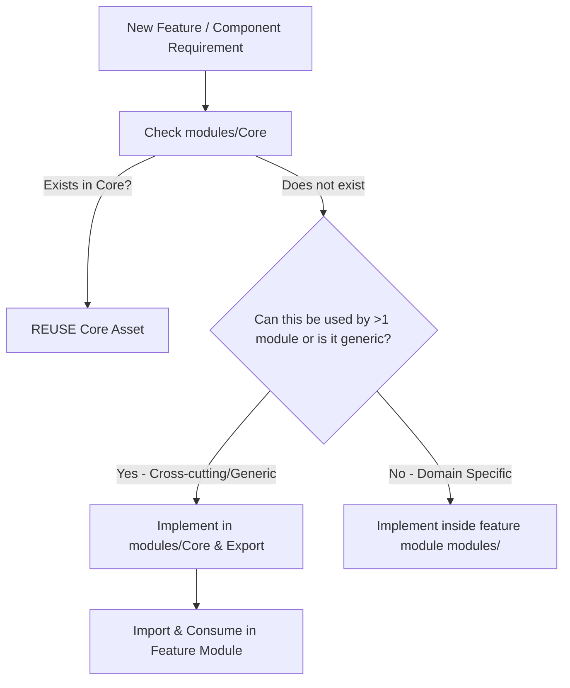

# Core Module Guide & Reusability Manual

The `Core` module (`modules/Core/`) is the central architectural backbone of the application. It contains foundational services, base classes, reusable UI components, utilities, and middleware designed to be shared across all feature modules (`Crawler`, `User`, `Auth`, `Role`, `System`, `TiktokAccount`, etc.).

---

## 1. The Core-First Rule (Mandatory for AI Agents & Developers)

> [!IMPORTANT]
> **Check Core First $\rightarrow$ Reuse Existing $\rightarrow$ Promote New Shared Assets to Core.**
> Whenever implementing a new feature, endpoint, or UI component:
> 1. **Inspect Core**: Check if a similar component, trait, utility, or base class already exists in `modules/Core/`.
> 2. **Reuse If Available**: Always reuse existing Core solutions. Never duplicate code or reinvent standard components.
> 3. **Zero Redundant Overrides**: When extending `BaseRepository` or `BaseController`, **NEVER** re-implement methods already provided by the base class (`all()`, `paginate()`, `findById()`, `findOrFail()`, `create()`, `update()`, `delete()`). Repository interfaces must extend `BaseRepositoryInterface` rather than re-declaring these methods.
> 4. **Query via `$this->model`**: Inside repositories, always perform queries using `$this->model->...` instead of static model calls (e.g. `Permission::where(...)`).
> 5. **Ban on Barrel Re-Export `index.ts` Files**: Never create `index.ts` files solely for re-exporting (`export * from ...`). Always use explicit, direct imports pointing to the actual component, hook, or utility file.
> 6. **Evaluate Reusability**: If an asset is not yet in Core, assess whether other modules could benefit from it. If it is generic and cross-cutting, implement it in `modules/Core/`, export it, and consume it in your specific module.

---

## 2. Core Backend Capabilities (`modules/Core/src/`)

### 2.1. Base Classes & Infrastructure
| Class / Interface | Location | Responsibility & How to Use |
| :--- | :--- | :--- |
| **`BaseController`** | [`src/Controllers/BaseController.php`](file:///E:/Urekamedia/TIKTOK-CRAWLER/cms-tiktok-crawler/modules/Core/src/Controllers/BaseController.php) | Abstract base controller providing automated RESTful actions (`index`, `show`, `store`, `update`, `destroy`), query filtering, searching, eager loading, and standard response helpers. Every feature controller must extend this class. |
| **`BaseRepository`** | [`src/Repositories/BaseRepository.php`](file:///E:/Urekamedia/TIKTOK-CRAWLER/cms-tiktok-crawler/modules/Core/src/Repositories/BaseRepository.php) | Generic Eloquent data-access implementation providing `all()`, `findById()`, `create()`, `update()`, `delete()`, `paginate()`, and query builders. Feature repositories should extend this class. |
| **`BaseRepositoryInterface`** | [`src/Repositories/Interfaces/BaseRepositoryInterface.php`](file:///E:/Urekamedia/TIKTOK-CRAWLER/cms-tiktok-crawler/modules/Core/src/Repositories/Interfaces/BaseRepositoryInterface.php) | Standard contract for all repository implementations. |
| **`DynamicRouteResovle`** | [`src/Support/DynamicRouteResovle.php`](file:///E:/Urekamedia/TIKTOK-CRAWLER/cms-tiktok-crawler/modules/Core/src/Support/DynamicRouteResovle.php) | Automatic URL-to-Controller reflection and action dispatcher. Resolves `/admin/api/{module}/{controller}/{action?}` without explicit route declarations. |
| **`ModuleRegistry`** | [`src/Support/ModuleRegistry.php`](file:///E:/Urekamedia/TIKTOK-CRAWLER/cms-tiktok-crawler/modules/Core/src/Support/ModuleRegistry.php) | Discovers, caches, and registers active modules in the system. |

### 2.2. Traits
| Trait | Location | Purpose |
| :--- | :--- | :--- |
| **`ApiResponseTrait`** | [`src/Traits/ApiResponseTrait.php`](file:///E:/Urekamedia/TIKTOK-CRAWLER/cms-tiktok-crawler/modules/Core/src/Traits/ApiResponseTrait.php) | Standardizes JSON response formatting across all controllers: `respondSuccess($data, $message, $code)`, `respondPaginated($paginator, $message)`, `respondError($message, $code, $errors)`. |
| **`FilterSearchTrait`** | [`src/Traits/FilterSearchTrait.php`](file:///E:/Urekamedia/TIKTOK-CRAWLER/cms-tiktok-crawler/modules/Core/src/Traits/FilterSearchTrait.php) | Automates SQL query filtering (`?status=active`), full-text searching (`?search=keyword`), and sorting (`?sort=created_at&direction=desc`) based on `$searchableColumns` and `$filterableColumns`. |
| **`HasRolesAndPermissions`** | [`src/Traits/HasRolesAndPermissions.php`](file:///E:/Urekamedia/TIKTOK-CRAWLER/cms-tiktok-crawler/modules/Core/src/Traits/HasRolesAndPermissions.php) | Attaches RBAC permission check helpers to the User model. |

### 2.3. Utility Classes
| Class | Location | Usage |
| :--- | :--- | :--- |
| **`FetchApi`** | [`src/Utils/FetchApi.php`](file:///E:/Urekamedia/TIKTOK-CRAWLER/cms-tiktok-crawler/modules/Core/src/Utils/FetchApi.php) | Robust HTTP client wrapper for outgoing external API requests with retry and error handling. |
| **`UploadFile`** | [`src/Utils/UploadFile.php`](file:///E:/Urekamedia/TIKTOK-CRAWLER/cms-tiktok-crawler/modules/Core/src/Utils/UploadFile.php) | Secure file upload and storage management. |
| **`CheckFileUpload`** | [`src/Utils/CheckFileUpload.php`](file:///E:/Urekamedia/TIKTOK-CRAWLER/cms-tiktok-crawler/modules/Core/src/Utils/CheckFileUpload.php) | Mime-type, file size, and extension validation. |

---

## 3. Core Frontend Capabilities (`modules/Core/resources/js/`)

### 3.1. Reusable UI Components
All components are exported from [`@core/components`](file:///E:/Urekamedia/TIKTOK-CRAWLER/cms-tiktok-crawler/modules/Core/resources/js/components/index.ts).

| Component | Props Interface | Usage & Purpose |
| :--- | :--- | :--- |
| **`TableComponent`** | `TableComponentProps` | High-level data table integrated with Ant Design Table, server-side pagination, sorting, column visibility, and row actions. |
| **`ListLayout`** | `ListLayoutProps` | Standard full-page listing container with page title, filter toolbar, search input, action buttons, and responsive wrapper. |
| **`CardKPI`** | `CardKPIProps` | Metrics/Analytics card displaying title, total count, icon, trending badge (+/- percentage), and loading skeleton. |
| **`ResourceForm`** | `ResourceFormProps` | Dynamic schema-based CRUD form generator with built-in validation, submit handling, and reset state. |
| **`CustomModal`** | `CustomModalProps` | Standardized dialog wrapper with header, body, action buttons, and transition animations. |
| **`ConfirmDialog`** | `ConfirmDialogProps` | Confirmation popup for destructive actions (e.g., delete, cancel job, reset password). |
| **`StatusTag`** | `StatusTagProps` | Badge/tag for entity statuses (`pending`, `running`, `completed`, `failed`) with uniform color coding. |
| **`StatusDropdown`** | `StatusDropdownProps` | Inline status change dropdown for quick record status updates. |
| **`PageHeader`** | `PageHeaderProps` | Top bar of pages with title, breadcrumbs, and primary CTA buttons. |
| **`EmptyState`** | `EmptyStateProps` | Empty state placeholder with SVG illustrations and actionable guidance when no data exists. |
| **`UploadComponent`** | `UploadComponentProps` | Drag-and-drop file uploader with progress indicators and file type validation. |
| **`PermissionGate`** | `PermissionGateProps` | Conditional renderer that displays child components only if the current user has the required permission. |
| **`PermissionMatrix`**| `PermissionMatrixProps`| Interactive role-permission grid for configuring RBAC access across modules and actions. |
| **`SpinComponent`** | - | Loading spinner indicator for async views and widgets. |

### 3.2. Central HTTP Client (`@core/Action/api`)
Located at [`modules/Core/resources/js/Action/api.ts`](file:///E:/Urekamedia/TIKTOK-CRAWLER/cms-tiktok-crawler/modules/Core/resources/js/Action/api.ts):
- Resolves the API `baseURL` from `.env` (`VITE_API_URL`).
- Automatically injects the CSRF token header (`X-CSRF-TOKEN`).
- Injects `Authorization: Bearer <token>` when the user is authenticated.
- Uniformly catches errors and throws typed `ApiError` instances.

### 3.3. Utilities (`@core/utils`)
- **`formatNumber(val)`**: Formats raw numbers with thousand separators.
- **`formatCurrency(val, currency)`**: Formats monetary values with currency symbols.
- **`formatDate(date, format)`**: Standardized date and time formatting via Day.js.
- **`storage`**: LocalStorage and SessionStorage typed helper with JSON serialization.
- **`validationDateUtil`**: Helpers for validating date ranges.

### 3.4. Layouts & Contexts
- **`AdminLayout`**: Master shell containing responsive Sidebar, Header, Breadcrumbs, and content container.
- **`AuthContext`** / **`useCurrentUser`**: Accesses the current authenticated user, roles, and allowed modules.
- **`usePermission`**: Hook for checking granular user permissions (`can('crawler', 'edit')`).

---

## 4. Promotion Criteria: When to Add to Core

When developing a feature inside a specific module (e.g., `Crawler` or `TiktokAccount`), promote the asset to `Core` if it satisfies **at least two** of the following criteria:
1. **Domain Agnostic**: The logic or component does not depend on business entities specific to one module (e.g., a generic date range picker or a batch CSV export service).
2. **Multi-Module Demand**: Two or more modules need identical or near-identical functionality.
3. **Architectural Standardization**: The asset establishes a design standard (e.g., custom notification toast, error boundary, or audit logging trait).

### Process for Adding to Core:
1. Place the backend code in `modules/Core/src/<Subdir>/` or frontend code in `modules/Core/resources/js/<Subdir>/`.
2. Export the component/utility in the module's public entrypoint (e.g., `modules/Core/resources/js/components/index.ts`).
3. Ensure 100% strict TypeScript types and provide docstrings in English.
4. Add corresponding test coverage in `tests/Unit/` or `tests/Feature/`.
