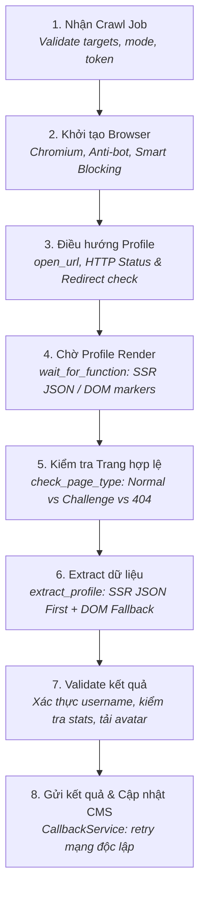

# TikTok Crawler Service - Architectural & Operational Manual

> **Module:** `ProcessData/tiktok-crawler`  
> **Tech Stack:** Python 3.12, FastAPI, Playwright (Chromium), BeautifulSoup4, Pydantic, HTTPX  
> **Repository:** `TIKTOK-CRAWLER-CMS`

---

## 1. Giới thiệu tổng quan

**TikTok Crawler Service** là một background microservice độc lập được xây dựng bằng Python, phụ trách việc thu thập thông tin hồ sơ (profile metadata và chỉ số thống kê) từ nền tảng TikTok cho hệ thống **CMS TikTok Crawler Platform**.

Service được thiết kế để:
1. **Chống nhận diện Bot:** Vượt qua các cơ chế kiểm tra tự động của TikTok trong môi trường headless/container mà không cần dùng dịch vụ giải captcha trả phí.
2. **Tiết kiệm RAM & Băng thông:** Hạn chế tối đa tài nguyên trong môi trường container (Render/Docker) nhờ cơ chế chặn media streams.
3. **Trích xuất chính xác 100%:** Sử dụng chiến lược 2 tầng (ưu tiên dữ liệu Server-Side Rendered JSON nhúng trước khi dùng DOM fallback).
4. **Phân tách trách nhiệm sạch (Separation of Concerns):** Phân chia rõ ràng giữa điều hướng browser, bóc tách HTML, kiểm tra dữ liệu và gửi callback.

---

## 2. Cấu trúc thư mục & Phân chia trách nhiệm

```text
ProcessData/tiktok-crawler/
├── app/
│   ├── main.py                  # Entrypoint khởi động Uvicorn server
│   ├── api.py                   # FastAPI app, định nghĩa routes (/health, /api/crawl-jobs/start)
│   ├── config.py                # Đọc và chuẩn hóa cấu hình từ biến môi trường
│   ├── models.py                # Pydantic DTO (TikTokAccount)
│   ├── crawler.py               # TikTokCrawler: Điều phối vòng đời Job (Bước 1, 2, 8)
│   ├── extractor.py             # Parser thuần túy: Phân loại trang & trích xuất JSON/DOM (Bước 6)
│   ├── services/
│   │   ├── profile_crawler.py   # ProfileCrawler: Crawl 1 profile cụ thể (Bước 3, 4, 5, 7)
│   │   ├── avatar_service.py    # Tải avatar và lưu trữ trực tiếp vào thư mục public của CMS
│   │   └── callback_service.py  # Gửi webhook về Laravel với cơ chế retry lỗi mạng độc lập
│   └── utils/
│       ├── browser_utils.py     # Điều hướng trình duyệt cơ bản (open_url, go_back, scroll_page)
│       └── tiktok_utils.py      # Chuẩn hóa username, URL profile, phát hiện video feed
├── tests/
│   ├── test_crawler.py          # Unit tests cho Smart Blocking, SSR JSON & Page Classifier
│   ├── test_browser_utils.py    # Unit tests cho NavigationError, go_back, safe_wait
│   ├── test_profile_crawler.py  # Unit tests cho quy trình crawl profile, private, mismatch
│   ├── test_avatar_service.py   # Unit tests cho đường dẫn lưu avatar trong container & local
│   └── test_callback_service.py # Unit tests cho HTTP retry callback
├── requirements.txt             # Danh sách thư viện Python
└── README.md                    # Tài liệu hướng dẫn nhanh cho developer
```

---

## 3. Quy trình Crawl 8 bước (8-Step Lifecycle Workflow)

Quy trình xử lý một Job được chuẩn hóa thành 8 bước nghiêm ngặt:



| Bước | Thực hiện tại | Hành vi chính | Xử lý khi thất bại / Lỗi |
| :--- | :--- | :--- | :--- |
| **1. Nhận job** | `api.py` / `crawler.py` | Kiểm tra chế độ crawl (`usernames`, `urls`, `count`), chuẩn hóa target. | Trả về `400/422` nếu request không hợp lệ; hủy job ngay. |
| **2. Khởi tạo browser** | `crawler.py` | Mở Playwright Chromium headless với cờ `--disable-blink-features=AutomationControlled`, xóa `navigator.webdriver`, bật Smart Blocking. | Ghi log exception, gửi callback trạng thái `failed` về CMS. |
| **3. Điều hướng** | `profile_crawler.py` / `browser_utils.py` | `open_url()` đến URL profile. Kiểm tra response status code và URL redirect. | Nếu `NavigationError` (timeout, rớt mạng) $\rightarrow$ Dừng ngay, không lấy `page.content()`. Nếu 404/403 $\rightarrow$ Ghi nhận lỗi HTTP. |
| **4. Chờ render** | `profile_crawler.py` | `page.wait_for_function()` chờ SSR script có `userInfo` HOẶC DOM `followers-count` xuất hiện. | Không chờ mù 3–10s: trả về ngay khi có dữ liệu (thường < 1s); timeout 10s sẽ tiếp tục trích xuất chẩn đoán. |
| **5. Kiểm tra trang** | `profile_crawler.py` / `extractor.py` | `check_page_type()` phân biệt: `profile`, `private`, `challenge`, `not_found`, `unknown`. | Nếu là `challenge` hoặc `not_found` $\rightarrow$ Raise `ExtractorPageError`, không sinh dữ liệu rác. |
| **6. Extract dữ liệu** | `extractor.py` | Đọc SSR JSON nhúng lấy số nguyên gốc (`163000000`); fallback DOM nếu JSON thiếu. So sánh `target_username`. | Xác định danh sách `missing_fields`. Bảo toàn giá trị `0` (không coi 0 là rỗng). |
| **7. Validate kết quả** | `profile_crawler.py` | Xác minh username trên trang khớp target. Nếu stats = 0 và không private, thử chờ DOM hydration bù 3s. Tải avatar. | Nếu username không khớp hoặc hoàn toàn không có dữ liệu thật $\rightarrow$ Báo `failed`. Nếu `page_type == "private"` $\rightarrow$ Báo `success` với status `private`. |
| **8. Gửi callback** | `callback_service.py` | Gửi HTTP POST event `account` và `completed` về Laravel webhook. | Tự động retry 3 lần với exponential backoff. Lỗi mạng không làm crawl lại profile đã lấy xong. |

---

## 4. Kỹ thuật Chống chặn & Tối ưu tài nguyên

### 4.1. Headless Bot Evasion Layer
Khi chạy Chromium headless trên container (nhất là Render IP Datacenter), TikTok mặc định nhận diện qua:
1. Cờ `navigator.webdriver = true`.
2. Header User-Agent chứa cờ `HeadlessChrome`.
3. Thiếu các thuộc tính plugin / runtime của browser thật.

**Giải pháp đã cài đặt:**
* Cờ khởi chạy: `--disable-blink-features=AutomationControlled`, `--no-sandbox`, `--disable-dev-shm-usage`, `--disable-gpu`.
* Injected Script tại `new_context`:
  ```python
  await context.add_init_script(
      "Object.defineProperty(navigator, 'webdriver', {get: () => undefined})"
  )
  ```
* Thiết lập `locale="en-US"` và User-Agent desktop tiêu chuẩn của Chrome 131.

### 4.2. Smart Blocking Route Handler
Để tránh tràn RAM 512MB trên Render, crawler chặn triệt để:
* **Tài nguyên Media (`BLOCKED_RESOURCE_TYPES = {"media"}`):** Hủy ngay các luồng phát video `.mp4`, audio streams.
* **Tracker bên thứ ba (`BLOCKED_URL_PATTERNS`):** Hủy `google-analytics.com`, `googletagmanager.com`, `doubleclick.net`, `facebook.net`, `analytics.tiktok.com`.
* **Bảo toàn Scripts quan trọng:** Cho phép các script nội bộ của TikTok (`webmssdk`, `slardar`) tải bình thường để React hydrate profile data.

---

## 5. Chiến lược trích xuất dữ liệu 2 tầng (Dual Extraction Engine)

### 5.1. Tầng 1: SSR Rehydration JSON (Ưu tiên số 1)
TikTok là ứng dụng SSR. Ngay trong payload HTML đầu tiên trả về, dữ liệu đã nằm sẵn tại:
* `<script id="__UNIVERSAL_DATA_FOR_REHYDRATION__" type="application/json">` $\rightarrow$ `__DEFAULT_SCOPE__["webapp.user-detail"]["userInfo"]`
* `<script id="SIGI_STATE" type="application/json">` $\rightarrow$ `UserModule["stats"]`, `UserModule["users"]`
* `<script id="__NEXT_DATA__" type="application/json">`

**Ưu điểm vượt trội:**
1. **Chính xác 100%:** Trả về số nguyên tuyệt đối (`163,000,000` followers, `2,691,752,966` likes) thay vì bị làm tròn như `163M` hay `2.7B` trên DOM.
2. **Miễn nhiễm với lag CPU:** Có sẵn ngay từ byte đầu tiên, không phụ thuộc vào việc trình duyệt có thực thi kịp JavaScript để vẽ DOM hay không.

### 5.2. Tầng 2: DOM Selectors (Fallback)
Khi thẻ script SSR không có mặt, crawler bóc tách từ các selector:
* Username: `[data-e2e="user-subtitle"]`, `[data-e2e="user-title"]`, `h1`, `h2`.
* Followers: `strong[data-e2e="followers-count"]`, `strong[title="Followers"]`.
* Following: `strong[data-e2e="following-count"]`, `strong[title="Following"]`.
* Likes: `strong[data-e2e="likes-count"]`, `strong[title="Likes"]`.

### 5.3. Bảo toàn số liệu = 0 hợp lệ vs Thiếu dữ liệu (`None`)
* Sử dụng hàm `_extract_first_present(data, *keys)` kiểm tra sự tồn tại của key.
* Nếu tài khoản mới có `followerCount: 0`, giá trị được lưu là `0` và **không bị đưa vào `missing_fields`**.
* Chỉ khi trường dữ liệu hoàn toàn không có trong cả JSON lẫn DOM mới được đánh dấu là `missing`.

---

## 6. Ma trận Phân loại Trang (Page Classification Matrix)

Hàm `check_page_type(soup, html)` phân loại chính xác tình trạng trang:

| Loại trang | Dấu hiệu nhận diện | Hành vi xử lý của Crawler |
| :--- | :--- | :--- |
| **`challenge`** | Chứa `slardar_us_waf`, `verify-center`, `captcha_verify_container`, `secsdk-captcha`, hoặc redirect `/login`, `/verify`. | Dừng ngay, ném `ExtractorPageError`, báo lỗi `challenge` về CMS kèm URL/Title. |
| **`not_found`** | Chứa `user-not-found`, `"couldn't find this account"`, hoặc HTTP `404`. | Dừng ngay, ném `ExtractorPageError`, báo lỗi tài khoản không tồn tại. |
| **`private`** | Chứa `"this account is private"` hoặc DOM private badge. | Xác nhận profile riêng tư, lưu `status = "private"`, lấy avatar và số liệu công khai (nếu có). |
| **`profile`** | Chứa script rehydration có `"userInfo"` hoặc DOM có `followers-count` / `user-title`. | Trích xuất toàn bộ thông tin profile. |
| **`unknown`** | Không khớp các mẫu trên. | Thử trích xuất; nếu không có bằng chứng hợp lệ sẽ đánh dấu `failed`. |

---

## 7. API Contract & Webhook Payloads

### 7.1. API Bắt đầu Crawl: `POST /api/crawl-jobs/start`

**Endpoint:** `http://localhost:8001/api/crawl-jobs/start`  
**Response Code:** `202 Accepted`

**Payload 1: Crawl theo danh sách Usernames**
```json
{
  "job_id": 15,
  "source_type": "usernames",
  "usernames": ["khaby.lame", "charlidamelio"],
  "callback_url": "https://cms-tiktok-web.onrender.com/admin/api/public/crawler"
}
```

**Payload 2: Crawl theo danh sách URLs**
```json
{
  "job_id": 16,
  "source_type": "urls",
  "urls": ["https://www.tiktok.com/@khaby.lame"]
}
```

**Payload 3: Khám phá tự động từ TikTok Feed**
```json
{
  "job_id": 17,
  "source_type": "count",
  "total_accounts": 10
}
```

---

### 7.2. Outbound Webhook Callbacks về CMS Laravel

Crawler gửi các sự kiện về URL:  
`POST {callback_url}/crawl-jobs/{job_id}/events`

#### Event 1: `account` (Kết quả crawl của 1 tài khoản)
```json
{
  "event": "account",
  "job_id": 15,
  "status": "success",
  "account": {
    "username": "khaby.lame",
    "followers": 163000000,
    "following": 82,
    "likes": 2691752966,
    "profile_url": "https://www.tiktok.com/@khaby.lame",
    "avatar_url": "https://p16-sign.tiktokcdn.com/...jpeg",
    "avatar_path": "tiktok-accounts/avatars/khaby.lame.jpeg",
    "crawled_at": "2026-10-29T15:30:00",
    "last_crawled_at": "2026-10-29T15:30:00",
    "status": "active"
  }
}
```

*Trường hợp crawl thất bại:*
```json
{
  "event": "account",
  "job_id": 15,
  "status": "failed",
  "username": "deleted_user",
  "profile_url": "https://www.tiktok.com/@deleted_user",
  "error_message": "HTTP 404: TikTok account @deleted_user not found or deleted"
}
```

#### Event 2: `completed` (Thông báo hoàn tất toàn bộ Job)
```json
{
  "event": "completed",
  "job_id": 15,
  "status": "completed",
  "total_accounts": 2,
  "success_count": 2,
  "failed_count": 0
}
```

---

## 8. Danh mục Biến môi trường (Environment Variables)

| Biến môi trường | Mặc định | Ý nghĩa |
| :--- | :--- | :--- |
| `CRAWLER_HOST` | `0.0.0.0` | Địa chỉ IP host để FastAPI lắng nghe. |
| `CRAWLER_PORT` | `8001` | Cổng dịch vụ FastAPI. |
| `HEADLESS` | `true` (trên Linux) / `false` (Windows) | Chế độ chạy ẩn trình duyệt Chromium. |
| `BACKEND_CALLBACK_URL` | `http://localhost:8000/admin/api/public/crawler` | Webhook URL mặc định của Laravel CMS. |
| `CALLBACK_TOKEN` | `None` | Bearer Token xác thực callback nếu backend yêu cầu. |
| `USER_AGENT` | Chrome 131 Desktop UA | User-Agent gửi kèm trong các request của browser. |
| `PUBLIC_DIR` | Auto-detect `cms-tiktok-crawler/public` | Thư mục public web của Laravel để lưu trữ avatar tĩnh. |
| `AVATAR_DIR` | `{PUBLIC_DIR}/tiktok-accounts/avatars` | Đường dẫn thư mục lưu ảnh đại diện tải về. |

---

## 9. Hướng dẫn Khởi chạy & Kiểm thử

### 9.1. Khởi chạy Cục bộ (Local Development)

1. Cài đặt thư viện:
   ```bash
   cd ProcessData/tiktok-crawler
   pip install -r requirements.txt
   playwright install chromium
   ```

2. Khởi động Crawler service:
   ```bash
   python app/main.py
   ```
   Service sẽ sẵn sàng tại `http://localhost:8001`. Kiểm tra sức khỏe: `curl http://localhost:8001/health`.

### 9.2. Chạy toàn bộ Unit Tests

Tất cả unit test được viết bằng module `unittest` chuẩn của Python:
```bash
python -m unittest discover -s ProcessData/tiktok-crawler/tests
```
*Kết quả chuẩn: 27/27 tests passed trong ~0.5s.*
