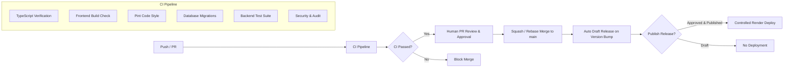

# CI/CD Pipeline Architecture & Quality Gates

This document defines the continuous integration and deployment architecture for the `cms-tiktok-crawler` repository using GitHub Actions.

---

## 1. Pipeline Overview & Design Principles

The CI/CD pipeline enforces the following invariants:
1. **Zero-Error Standard**: All PRs and pushes to core branches must pass strict TypeScript compilation and 100% of backend tests.
2. **Shift-Left Security**: Secret leak prevention, dependency vulnerability audits (`composer audit`, `npm audit`), and lockfile validation run automatically.
3. **Reproducibility**: Locked dependencies (`package-lock.json`, `composer.lock`) and pinned runtimes (Node 20, PHP 8.3) are used across all runners.
4. **Separation of Concerns**: CI validates code quality; Release workflows package immutable distribution assets; CD deploys strictly on approved, published releases.

---

## 2. GitHub Actions Workflows Breakdown

### 2.1 `ci.yml` — Continuous Integration Pipeline
- **Triggers**:
  - `push` to `main`, `develop`, and `feature/**`, `fix/**`, `hotfix/**`, `refactor/**`, `test/**`, `docs/**`, `chore/**`, `ci/**`, `worktree-*`.
  - `pull_request` targeting `main` or `develop`.
- **Jobs**:
  1. `typecheck-and-frontend`:
     - Sets up Node.js 20 with npm cache.
     - Runs `npm ci`.
     - Executes `npm run check-types` (`tsc --noEmit`). Must produce 0 errors.
     - Verifies frontend build compilation.
  2. `backend-tests-and-migrations`:
     - Sets up PHP 8.3 with required extensions (`mbstring, xml, pdo, pdo_sqlite, redis, bcmath, intl`).
     - Validates composer configuration: `composer validate --strict`.
     - Caches composer vendor dependencies.
     - Checks code formatting via `vendor/bin/pint --test`.
     - Tests SQLite in-memory migrations: `php artisan migrate --force`.
     - Runs Pest / PHPUnit test suite: `php artisan test`. Must achieve 100% pass rate.
  3. `security-audit`:
     - Checks Composer packages for known vulnerabilities via `composer audit --locked`.
     - Checks Node dependencies via `npm audit --audit-level=high`.

### 2.2 `auto-draft-release.yml` — Automated Draft Release Generator
- **Triggers**:
  - `push` to `main` modifying `cms-tiktok-crawler/package.json`.
  - Manual `workflow_dispatch`.
- **Behavior**:
  - Compares version in `cms-tiktok-crawler/package.json` with previous commit.
  - Generates distribution archive (`dist/cms-tiktok-crawler-vX.Y.Z.tar.gz`).
  - Compiles release notes from conventional commits.
  - Creates a **GitHub Draft Release** (`draft: true`).
  - **Does NOT trigger deployment**.

### 2.3 `release.yml` — Tag-based Release Pipeline
- **Triggers**:
  - `push` of tags matching `v*.*.*`.
- **Behavior**:
  - Differentiates official releases from pre-releases (`-rc`, `-beta`, `-alpha`).
  - Packages release assets and publishes GitHub Release metadata.

### 2.4 `deploy.yml` — Controlled Render Deployment & Health Verification
- **Triggers**:
  - `release` with `types: [published]`.
  - Authorized `workflow_dispatch` with release tag, commit SHA, and explicit `"DEPLOY"` confirmation.
- **Behavior**:
  - Invokes Render Deploy Webhooks for Web, Crawler Worker, and Queue Worker.
  - Probes `https://cms-tiktok-web.onrender.com/api/health` with exponential retry backoff.
  - Verifies HTTP 200 and `"status": "healthy"`.
  - Halts with critical failure and emits rollback instructions if unhealthy.

---

## 3. Required Checks vs. Optional Checks

| Check Name | Workflow | Status | Failure Action |
| :--- | :--- | :--- | :--- |
| `Strict TypeScript Verification` | `ci.yml` | **Mandatory** | Blocks PR merge |
| `Backend Test Suite` | `ci.yml` | **Mandatory** | Blocks PR merge |
| `Database Migration Check` | `ci.yml` | **Mandatory** | Blocks PR merge |
| `Pint Code Style Check` | `ci.yml` | **Mandatory** | Blocks PR merge |
| `Security Audit (Composer/NPM)` | `ci.yml` | Advisory | Warns in summary |
| `Post-Deploy Health Check` | `deploy.yml` | **Mandatory** | Triggers rollback alert |

---

## 4. Branch Protection Configuration (Repository Owner)

Repository administrators should configure branch protection rules for `main` on GitHub:
1. Navigate to **Settings** -> **Branches** -> **Add branch protection rule**.
2. Branch name pattern: `main`.
3. Check **Require a pull request before merging**:
   - Require approvals: minimum `1`.
   - Dismiss stale pull request approvals when new commits are pushed.
4. Check **Require status checks to pass before merging**:
   - Require branches to be up to date before merging.
   - Required status checks:
     - `Frontend Strict TypeScript & Build`
     - `Backend Tests, Linting & Migrations`
5. Check **Do not allow bypassing the above settings**.
