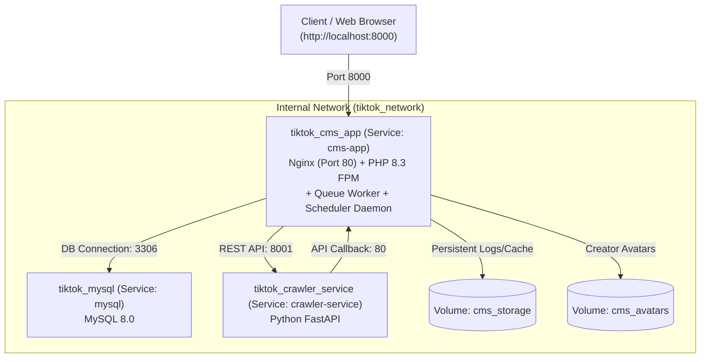

# Docker Deployment & Containerization Guide

This guide provides end-to-end instructions for building, running, and managing the **CMS TikTok Crawler** platform using Docker, Docker Compose, and Cloud PaaS (Render.com).

---

## 1. Architecture Overview

The system is partitioned into high-performance containerized services connected via the internal bridge network `tiktok_network`:

| Container | Image / Source | Port | Role |
|---|---|---|---|
| **`tiktok_mysql`** | `mysql:8.0` | `3306` | Relational database for CMS |
| **`tiktok_cms_app`** | `./cms-tiktok-crawler` | `8000:80` | Laravel 13 + React SPA + Nginx + Queue + Schedule (All-in-One) |
| **`tiktok_crawler_service`** | `./tiktok-crawler-service` | `8001:8001`| Python FastAPI Crawler Engine + SQLite WAL |



### Highlights of the All-in-One CMS Container:
1. **Render.com Ready**: Nginx runs in foreground on HTTP port 80 (or dynamic `$PORT` provided by Render), immediately satisfying Render's HTTP health check scanners.
2. **Built-in Queue Worker**: Runs continuously in background with a supervisor loop to automatically restart on exit or memory refresh.
3. **Built-in Scheduler Daemon**: Runs `php artisan schedule:work` every minute in background to trigger periodic cron tasks without requiring system cron daemon.
4. **Cost Efficient**: Single Web Service on Render covers Web, Queue, and Cron, saving \$14–\$20/month.

---

## 2. Prerequisites

- Docker Desktop 24.0+ (with Compose V2)
- Minimum 4GB RAM allocated to Docker Engine
- Ports `8000`, `8001`, and `3306` available on the host machine

---

## 3. Environment Configuration

Copy the example Docker environment file:

```bash
cp .env.docker.example .env
```

Review and adjust variables as needed:
- `CMS_PORT`: Host port for the CMS Web UI & API (Default: `8000`).
- `CRAWLER_PORT`: Host port for the Python Crawler API (Default: `8001`).
- `DB_PORT`: Host port for MySQL database (Default: `3306`).
- `DB_DATABASE`, `DB_USERNAME`, `DB_PASSWORD`: Database credentials.

---

## 4. Building Images

### Option A: Build All Images Together with Docker Compose

Run from the monorepo root directory:

```bash
# Build all images without starting containers
docker compose build

# Build with no cache (clean rebuild)
docker compose build --no-cache
```

### Option B: Build Individual Images Separately

#### 1. CMS Web, API, Queue & Schedule (`cms-tiktok-crawler`)
```bash
# Method 1: Via Docker Compose
docker compose build cms-app

# Method 2: Via standalone Docker build
docker build -t cms-tiktok-crawler ./cms-tiktok-crawler

# Method 3: From within the service directory
cd cms-tiktok-crawler
docker build -t cms-tiktok-crawler .
```

#### 2. Python Crawler Service (`tiktok-crawler-service`)
```bash
# Method 1: Via Docker Compose
docker compose build crawler-service

# Method 2: Via standalone Docker build
docker build -t tiktok-crawler-service ./tiktok-crawler-service

# Method 3: From within the service directory
cd tiktok-crawler-service
docker build -t tiktok-crawler-service .
```

---

## 5. Running the Stack

### Start All Services

```bash
# Start all containers in the background (detached mode)
docker compose up -d

# Check status of running containers
docker compose ps
```

### Accessing Services

- **CMS Web Application**: [http://localhost:8000](http://localhost:8000)
- **CMS Health Endpoint**: [http://localhost:8000/api/health](http://localhost:8000/api/health)
- **Crawler API Swagger Docs**: [http://localhost:8001/docs](http://localhost:8001/docs)
- **Crawler Health Endpoint**: [http://localhost:8001/api/v1/health](http://localhost:8001/api/v1/health)

### Realtime Crawler Dashboard

```bash
# Run realtime CLI dashboard
docker compose exec crawler-service python scripts/status.py --watch
```

### Stopping Services

```bash
# Stop containers without removing persistent data
docker compose down

# Stop and remove named volumes (WARNING: wipes database data)
docker compose down -v
```

---

## 6. Deploying to Render.com

To deploy this setup to **Render.com**:

1. **Database**: Use a managed MySQL service (Aiven, PlanetScale, AWS RDS) or deploy MySQL as a Render Private Service with persistent disk mounted to `/var/lib/mysql`.
2. **CMS Web Service**:
   - Create a **Web Service** on Render.
   - Root Directory: `cms-tiktok-crawler`
   - Dockerfile Path: `Dockerfile`
   - Render automatically assigns dynamic `$PORT` (e.g. 10000), which `entrypoint.sh` binds automatically.
   - Health check: `/api/health`.
3. **Crawler Service**:
   - Create a **Web Service** (or **Private Service**).
   - Root Directory: `tiktok-crawler-service`
   - Dockerfile Path: `Dockerfile`
   - Port: `8001`.
   - Health check: `/api/v1/health`.
