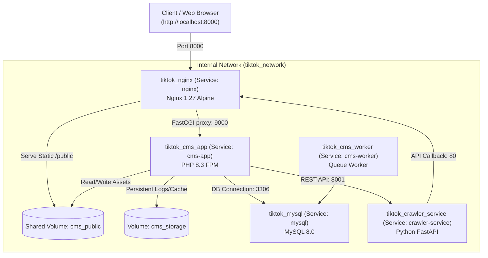

# Docker Deployment & Containerization Guide

This guide provides end-to-end instructions for building, running, and managing the **CMS TikTok Crawler** platform using Docker and Docker Compose.

---

## 1. Architecture Overview

The system is partitioned into modular containerized services connected via the internal bridge network `tiktok_network`:

| Container | Image / Source | Port | Role |
|---|---|---|---|
| **`tiktok_mysql`** | `mysql:8.0` | `3306` | Primary relational database for CMS |
| **`tiktok_cms_app`** | `./cms-tiktok-crawler` | `9000` (internal) | Pure Laravel 13 PHP 8.3-FPM backend |
| **`tiktok_nginx`** | `./nginx` | `8000:80` | Dedicated Nginx reverse proxy & static asset server |
| **`tiktok_cms_worker`**| `./cms-tiktok-crawler` | — | Laravel Queue Worker (`queue:work`) |
| **`tiktok_crawler_service`** | `./tiktok-crawler-service` | `8001:8001`| Python FastAPI Crawler Engine + SQLite WAL |



---

## 2. Prerequisites

- Docker Desktop 24.0+ (with Compose V2)
- Minimum 4GB RAM allocated to Docker Engine
- Ports `8000`, `8001`, and `3306` available on the host machine

---

## 3. Environment Configuration

Copy the example Docker environment file:

```bash
cp .env.docker.example .env
```

Review and adjust variables as needed:
- `CMS_PORT`: Host port for the Nginx Web UI & API (Default: `8000`).
- `CRAWLER_PORT`: Host port for the Python Crawler API (Default: `8001`).
- `DB_PORT`: Host port for MySQL database (Default: `3306`).
- `DB_DATABASE`, `DB_USERNAME`, `DB_PASSWORD`: Database credentials.

---

## 4. Building Images

### Option A: Build All Images Together with Docker Compose

Run from the monorepo root directory:

```bash
# Build all images without starting containers
docker compose build

# Build with no cache (clean rebuild)
docker compose build --no-cache
```

### Option B: Build Individual Images Separately

You can build any service image independently using either **Docker Compose targets** or **native `docker build`**.

#### 1. Nginx Reverse Proxy (`nginx`)
```bash
# Method 1: Via Docker Compose
docker compose build nginx

# Method 2: Via standalone Docker build
docker build -t tiktok-nginx ./nginx

# Method 3: From within the service directory
cd nginx
docker build -t tiktok-nginx .
```

#### 2. CMS Backend PHP-FPM (`cms-tiktok-crawler`)
```bash
# Method 1: Via Docker Compose
docker compose build cms-app

# Method 2: Via standalone Docker build
docker build -t cms-tiktok-crawler ./cms-tiktok-crawler

# Method 3: From within the service directory
cd cms-tiktok-crawler
docker build -t cms-tiktok-crawler .
```

#### 3. Python Crawler Service (`tiktok-crawler-service`)
```bash
# Method 1: Via Docker Compose
docker compose build crawler-service

# Method 2: Via standalone Docker build
docker build -t tiktok-crawler-service ./tiktok-crawler-service

# Method 3: From within the service directory
cd tiktok-crawler-service
docker build -t tiktok-crawler-service .
```

---

## 5. Running the Stack

### Start All Services

```bash
# Start all containers in the background (detached mode)
docker compose up -d

# Check status of running containers
docker compose ps
```

### Accessing Services

- **CMS Web Application**: [http://localhost:8000](http://localhost:8000)
- **CMS Health Endpoint**: [http://localhost:8000/api/health](http://localhost:8000/api/health)
- **Crawler API Swagger Docs**: [http://localhost:8001/docs](http://localhost:8001/docs)
- **Crawler Health Endpoint**: [http://localhost:8001/api/v1/health](http://localhost:8001/api/v1/health)

### Stopping Services

```bash
# Stop containers without removing persistent data
docker compose down

# Stop and remove named volumes (WARNING: wipes database data)
docker compose down -v
```

---

## 6. Common Operations & Maintenance

### View Logs

```bash
# Stream all logs
docker compose logs -f

# Stream logs for a specific service
docker compose logs -f nginx
docker compose logs -f cms-app
docker compose logs -f crawler-service
docker compose logs -f cms-worker
```

### Run Laravel Artisan Commands

```bash
# Run database migrations
docker compose exec cms-app php artisan migrate

# Seed database
docker compose exec cms-app php artisan db:seed

# Clear application cache
docker compose exec cms-app php artisan optimize:clear

# Interactive Tinker shell
docker compose exec cms-app php artisan tinker
```

### Access Container Shell

```bash
# Shell into CMS PHP-FPM container
docker compose exec cms-app sh

# Shell into Nginx container
docker compose exec nginx sh

# Shell into Python Crawler container
docker compose exec crawler-service bash

# MySQL CLI
docker compose exec mysql mysql -u tiktok_user -p tiktok_crawler
```

---

## 7. Persistent Data & Volumes

The Docker Compose configuration persists stateful data across restarts using named volumes:

- `tiktok_mysql_data`: Stores MySQL database tables (`/var/lib/mysql`).
- `tiktok_cms_public`: Shares compiled SPA assets and storage links between `cms-app` and `nginx` (`/var/www/html/public`).
- `tiktok_cms_storage`: Stores Laravel logs, cache, sessions (`/var/www/html/storage`).
- `tiktok_cms_avatars`: Stores crawled TikTok creator profile avatars (`/var/www/html/public/tiktok-accounts`).
- `tiktok_crawler_data`: Stores SQLite WAL queue and candidate database (`/app/data`).
- `tiktok_crawler_datasets`: Stores downloaded TikTok video datasets (`/app/datasets`).
