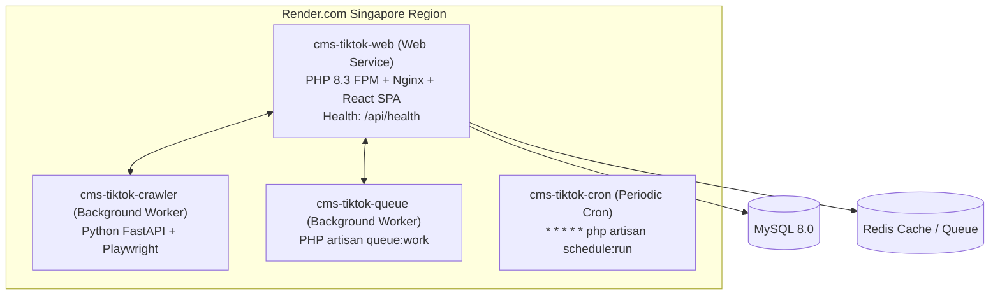

# Render Production Deployment & Rollback Playbook

This playbook documents the infrastructure, deployment triggers, post-deployment health verification, and rollback operations for the `cms-tiktok-crawler` platform hosted on Render.com.

---

## 1. Render Infrastructure as Code Architecture (`render.yaml`)

The platform is deployed using Render Blueprint IaC across four orchestrated services in the `singapore` region:



### Service Details:
1. **`cms-tiktok-web`** (Web Service):
   - **Dockerfile**: `docker/Dockerfile.web`
   - **Entrypoint**: `docker/start-web.sh` (Runs migrations if `RUN_MIGRATIONS=true`, config/route caching, PHP-FPM, and Nginx).
   - **Public URL**: `https://cms-tiktok-web.onrender.com`
   - **Health Check Path**: `/api/health`
2. **`cms-tiktok-crawler`** (Worker Service):
   - **Dockerfile**: `docker/Dockerfile.crawler`
   - **Port**: `8001`
   - **Callback**: `https://cms-tiktok-web.onrender.com/api/crawler/webhook`
3. **`cms-tiktok-queue`** (Worker Service):
   - **Command**: `php artisan queue:work --sleep=3 --tries=3 --max-time=3600 --queue=default,crawler,system`
4. **`cms-tiktok-cron`** (Cron Job):
   - **Schedule**: `* * * * *`
   - **Command**: `php artisan schedule:run`

---

## 2. Controlled Deployment Security Rules

To ensure strict production stability:
1. **Never Deploy from Feature Branches**: Feature branch pushes run CI checks but have zero access to production deployment triggers.
2. **Never Deploy on PRs**: Pull request validation strictly tests code quality.
3. **Never Deploy Merges into `main` Directly**: Merging a PR into `main` creates a Draft Release if the version is bumped, but never touches production.
4. **Never Deploy from Draft Releases**: Draft Releases remain idle until reviewed and published.
5. **Only Published Releases Deploy**: Production deployment activates **exclusively** upon publishing an approved GitHub Release (`vX.Y.Z`) or through an authorized, confirmed `workflow_dispatch`.

---

## 3. Deployment Workflow Execution (`deploy.yml`)

When a release is published:
1. **Release Validation Gate**: Extracts target release tag (`vX.Y.Z`) and verified commit SHA.
2. **Trigger Render Deploy Hooks**:
   - `RENDER_WEB_DEPLOY_HOOK`
   - `RENDER_CRAWLER_DEPLOY_HOOK`
   - `RENDER_QUEUE_DEPLOY_HOOK`
3. **Automated Health Check Loop**:
   - Probes `https://cms-tiktok-web.onrender.com/api/health` every 15 seconds (up to 20 attempts / 5 minutes).
   - Validates that the endpoint returns `HTTP 200 OK` and JSON containing `"status": "healthy"`.
4. **Audit Evidence Recording**:
   - Logs target environment, release tag, deployed commit SHA, and verified health timestamp.

---

## 4. Post-Deployment Verification & Smoke Tests

After deployment succeeds, perform standard smoke tests:
1. **Health Check Endpoint**:
   ```bash
   curl -i https://cms-tiktok-web.onrender.com/api/health
   ```
   Expected response:
   ```json
   {
     "status": "healthy",
     "service": "cms-tiktok-crawler-web",
     "timestamp": "2026-10-28T10:35:00+00:00"
   }
   ```
2. **Diagnostic Ping**:
   ```bash
   curl -i https://cms-tiktok-web.onrender.com/admin/api/core/core/ping
   ```

---

## 5. Rollback Procedures (Emergency & Automated)

If `deploy.yml` post-deployment health check fails, or if a critical bug is detected in production:

### Method A: Automated Redeploy via GitHub Actions (Recommended)
1. Navigate to **Actions** -> **Controlled Render Deployment & Health Verification**.
2. Click **Run workflow**.
3. Choose branch: `main`.
4. Target Environment: `production`.
5. Release tag to deploy: Enter the previous known-good tag (e.g., `v1.0.0`).
6. Confirmation: Type `DEPLOY`.
7. Click **Run workflow**. The pipeline triggers Render and verifies health of the previous release.

### Method B: Render Dashboard Rollback (Instant)
1. Log in to [Render Dashboard](https://dashboard.render.com).
2. Select `cms-tiktok-web` (and worker services if updated).
3. Navigate to the **Deploys** tab.
4. Find the last successful deploy preceding the failed release.
5. Click the three dots (`...`) next to that deploy and select **Rollback to this deploy**.

### Method C: Database Migration Rollback
If the failed release introduced database migrations that must be reverted:
1. Access the web service shell via Render Dashboard -> **Shell**.
2. Run:
   ```bash
   php artisan migrate:rollback --step=1
   ```
