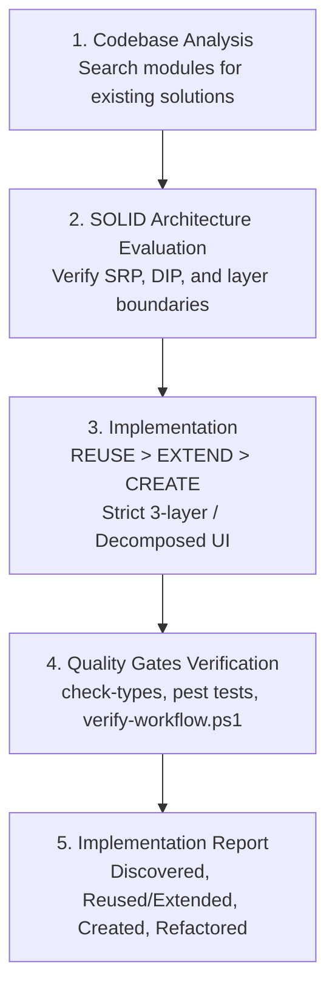

# SOLID Principles & Architectural Standards

This document establishes the mandatory **SOLID design principles**, code reusability strategies, and anti-pattern prevention guidelines across the monorepo for both the **Laravel 13 backend** and **React 19 frontend**.

All AI Agents and software engineers MUST adhere to these rules when designing, implementing, refactoring, or reviewing code.

---

## 1. Core Principles Overview

| Principle | Meaning | Backend Application (Laravel / PHP) | Frontend Application (React / TypeScript) |
| :--- | :--- | :--- | :--- |
| **S** - Single Responsibility | A class/component should have one reason to change | Separate Controller (HTTP), Service (Business), Repository (Data), FormRequest (Validation), Job (Queue). | Separate Page (Orchestration), Component (UI Render), Hook (State logic), Config (Static columns/options). |
| **O** - Open/Closed | Open for extension, closed for modification | Extend behavior via interfaces, middleware, strategy patterns, and event listeners rather than modifying core classes. | Component composition (`children`, render props), optional typed props, and pluggable configs without modifying core internals. |
| **L** - Liskov Substitution | Subtypes must be substitutable for base types | Repository implementations must honor `<Model>RepositoryInterface` return types, nullability, and error handling. | Specialized components (e.g. `CustomModal`, `TiktokVideoTable`) must honor standard AntD wrapper contracts and prop conventions. |
| **I** - Interface Segregation | Clients should not depend on methods they do not use | Lean, cohesive repository & service interfaces instead of monolithic 50-method God interfaces. | Narrow, decomposed prop interfaces. Never pass an entire 40-field entity when a component only needs 2 fields. |
| **D** - Dependency Inversion | Depend on abstractions, not on concretions | Services depend on Repository Interfaces; never on concrete classes or direct Eloquent Models (`Model::where()`). Bound via ServiceProvider. | Components depend on abstracted API clients (`@core/Action/api`) and custom hooks, decoupled from direct transport or browser primitives. |

---

## 2. Single Responsibility Principle (SRP)

### 2.1. Backend Architecture Layers
Every backend class MUST have a single, clearly delineated purpose:

1. **Controllers** (`src/Http/Controllers/`):
   - **Single Responsibility**: Handle HTTP request lifecycle (input gathering, invoking validation, delegating to Service, formatting JSON response).
   - **Forbidden**: Writing Eloquent queries, executing database transactions, calculating business metrics, or calling third-party APIs directly.
   - **Public Methods**: Every `public` method is an HTTP endpoint mapped via `DynamicRouteResovle`. Internal helpers MUST be `protected` or `private`.

2. **FormRequests** (`src/Http/Requests/`):
   - **Single Responsibility**: Request data validation and authorization logic.
   - **Forbidden**: Business side-effects, database mutation, or sending notifications.

3. **Services** (`src/Services/`):
   - **Single Responsibility**: Orchestrate domain business logic, manage transaction boundaries (`DB::transaction`), trigger audit events (`LogsActivity`/`ActivityLogger`), and dispatch background jobs.
   - **Forbidden**: Direct Model calls (`Model::where()`, `Model::create()`, `DB::table()`). Services MUST delegate 100% of data persistence to Repository Interfaces.
   - **Forbidden**: Reading global HTTP state (`request()`, `$_POST`, `session()`) directly. Accept validated DTOs or primitive values from controllers.

4. **Repositories** (`src/Repositories/`):
   - **Single Responsibility**: Encapsulate Eloquent query construction, eager loading (`with`), dynamic filtering (`FilterSearchTrait`), and database persistence.
   - **Forbidden**: Domain business logic, dispatching queues, or formatting HTTP responses.

5. **API Resources** (`src/Resources/`):
   - **Single Responsibility**: Transform Eloquent models/collections into standardized, sanitized JSON representations.

6. **Jobs** (`src/Jobs/`):
   - **Single Responsibility**: Execute a single asynchronous background task. Must be idempotent and handle retries gracefully.

### 2.2. Frontend Architecture Layers
Every frontend file MUST maintain a single level of responsibility:

1. **Pages** (`pages/`):
   - **Single Responsibility**: Route orchestration, parsing URL parameters (`useSearchParams`, `useParams`), and composing high-level layout.
   - **Forbidden**: Inline table column definitions (>40 lines), heavy data transformations, or inline SVG definitions. Extract to sub-components or `configs/`.

2. **Presentational Components** (`components/`):
   - **Single Responsibility**: Render UI strictly from typed props.
   - **Decomposition Rule**: Decompose any component exceeding ~150-200 lines or mixing layout with form validation and modal logic.

3. **Custom Hooks** (`hooks/`):
   - **Single Responsibility**: Encapsulate reusable stateful behavior, side-effects, or event subscriptions (e.g. `useAction`, `usePermission`).

4. **Redux Slices & Thunks** (`store/`):
   - **Single Responsibility**: Manage shared global state, server pagination, search filters, and multi-tab persistence.
   - **Forbidden**: Storing local UI state (e.g., single modal visibility or ephemeral input text).

5. **Static Configs** (`configs/`):
   - **Single Responsibility**: Hold static definitions such as table column schemas, form field presets, and filter dropdown options.

---

## 3. Open/Closed Principle (OCP)

Code should be easily extensible without modifying existing, tested source code.

### 3.1. Backend Extension Techniques
- **Strategy Pattern & Extractors**: When introducing a new crawler extractor or notification channel, implement a shared interface rather than expanding giant `switch ($platform)` blocks.
- **Middleware & Pipeline**: Extend request/response processing via middleware (`CheckModulePermission`, `SanctumAuth`) without modifying controller endpoints.
- **Service Providers**: Register module-specific bindings, event listeners, and routes in `<Module>ServiceProvider` without altering `Core` files.

### 3.2. Frontend Extension Techniques
- **Component Composition**: Use React `children`, render props, or slots to allow consumers to inject custom actions or headers into containers like `ListLayout` and `CustomModal`.
- **Prop Extension**: Add optional configuration props with sensible defaults instead of modifying or breaking existing prop interfaces.
- **Configurable Tables**: Extend `Table` behavior via column configs and render functions without duplicating table boilerplate.

---

## 4. Liskov Substitution Principle (LSP)

Derived classes and replacement components MUST be completely substitutable for their abstractions without breaking client code.

### 4.1. Backend Substitution Invariants
- **Repository Interface Compliance**: Any repository implementing `<Model>RepositoryInterface` must strictly honor method return types (e.g., returning `LengthAwarePaginator`, `Collection`, `Model`, or `null`). Never return an unexpected primitive or throw undocumented runtime exceptions.
- **Controller Inheritance**: Custom controllers extending `BaseController` must maintain consistent return structures (using `ApiResponseTrait`: `respondSuccess`, `respondError`, `respondPaginated`).

### 4.2. Frontend Substitution Invariants
- **Core Component Wrappers**: Specialized UI components (such as `TiktokVideoTable` or custom form pickers) that wrap Ant Design components must accept standard container props and emit predictable event callbacks (`onChange`, `onSelect`).
- **Polymorphic UI**: Interchangeable badge or status tag components (e.g., `StatusTag`) must handle equivalent status schemas without crashing.

---

## 5. Interface Segregation Principle (ISP)

Clients should never be forced to depend on methods, props, or contracts they do not use.

### 5.1. Backend Interface Granularity
- **Focused Repository Interfaces**: Split large domain operations into focused contracts. Do not pack unrelated analytics, export, and CRUD methods into a single massive interface.
- **Targeted Dependencies**: Inject only the specific interfaces a Service requires. A service that only needs to log activities should depend on `ActivityLoggerInterface`, not a comprehensive `AdministrationRepositoryInterface`.

### 5.2. Frontend Prop Segregation
- **Lean Component Props**: Components must only accept the data they genuinely need to render.
  ```typescript
  // BAD: Bloated interface passing unnecessary domain data
  interface UserAvatarProps {
    user: FullUserWithPermissionsRolesAndSettings;
  }

  // GOOD: Segregated, focused interface
  interface UserAvatarProps {
    name: string;
    avatarUrl?: string;
    size?: number | 'small' | 'large';
  }
  ```
- **Avoid "Prop Drilling" Mega-Objects**: Do not pass entire database records through 4 layers of component trees just to display a timestamp.

---

## 6. Dependency Inversion Principle (DIP)

High-level modules must not depend on low-level modules; both must depend on abstractions.

### 6.1. Backend Dependency Rules
1. **Controller -> Service**: Controllers depend on domain Services injected via the constructor.
2. **Service -> Repository Interface**: Services depend **strictly on Repository Interfaces** (`<Model>RepositoryInterface`), NEVER on concrete Eloquent Models or DB facades:
   ```php
   // BAD: High-level business service coupled to Eloquent implementation
   class CrawlJobService {
       public function cancel(int $id) {
           return CrawlJob::where('id', $id)->update(['status' => 'cancelled']); // VIOLATION
       }
   }

   // GOOD: Service depends on repository interface abstraction
   class CrawlJobService {
       public function __construct(
           protected CrawlJobRepositoryInterface $crawlJobRepo
       ) {}

       public function cancel(int $id): bool {
           return $this->crawlJobRepo->updateStatus($id, CrawlJobStatus::CANCELLED);
       }
   }
   ```
3. **IoC Container Binding**: All repository bindings MUST be registered in the module's `ServiceProvider`:
   ```php
   $this->app->bind(CrawlJobRepositoryInterface::class, CrawlJobRepository::class);
   ```

### 6.2. Frontend Dependency Rules
1. **Abstracted Network Layer**: Components and thunks MUST depend on the centralized HTTP client (`@core/Action/api`), which encapsulates Sanctum token injection, error interceptors, and baseURL handling. Never use raw `fetch()` or disparate Axios instances.
2. **Decouple View from Data Fetching**: Complex views should depend on custom hooks (`useAccounts`, `useCrawlJobs`) rather than embedding inline HTTP queries directly into JSX markup.

---

## 7. Anti-Pattern Prevention: God Classes & God Components

### 7.1. God Class Prevention (Backend)
- **Threshold**: Any Controller or Service exceeding ~300-350 lines or containing >7 injected dependencies is an architectural smell.
- **Remediation**:
  - Split multi-purpose Controllers into resource-specific controllers (e.g. `CrawlJobBatchController` vs `CrawlJobItemController`).
  - Decompose large Services into cohesive domain sub-services (e.g. `CrawlJobDispatcherService`, `CrawlJobResultService`).
  - Move complex database query assemblies from Services into dedicated methods on the Repository.

### 7.2. God Component Prevention (Frontend)
- **Threshold**: Any React component exceeding ~150-200 lines or fulfilling multiple UI responsibilities (e.g. rendering a filter toolbar, data table, and edit modal in one file) is a God Component.
- **Remediation**:
  - Extract subcomponents: `<FilterToolbar />`, `<DataTable />`, `<EditModal />`.
  - Extract static configs: Move AntD `columns` definitions and select options into `configs/tableConfig.ts`.
  - Extract side-effect logic into custom hooks.

---

## 8. Pragmatism: Avoiding Overengineering & Unnecessary Abstractions

SOLID principles must be applied with engineering pragmatism. Avoid speculative generalization:

- **Follow YAGNI & KISS**: Do not create generic wrapper classes, abstract factories, or intermediate interface layers for one-off, trivial operations that will never vary.
- **Leverage Framework Standards**: Use Laravel's built-in abstractions (`BaseController`, `BaseRepository`, `FormRequest`, `Resource`) rather than inventing custom micro-frameworks.
- **Base Classes**: Extend `Modules\Core\Http\Controllers\BaseController` and `Modules\Core\Repositories\BaseRepository` directly. Do not duplicate base CRUD mechanics.

---

## 9. Code Reusability: REUSE > EXTEND > CREATE

Before implementing any new functionality, AI Agents MUST apply the three-tier decision rule:

1. **REUSE**:
   - Search the monorepo across all modules (`Core`, `Crawler`, `TiktokAccount`, `User`, `System`) using `rg` or `Select-String`.
   - If an existing component, hook, or repository method satisfies the requirement, use it as-is.
2. **EXTEND**:
   - If an existing component or method covers ~80% of the requirement, extend it by adding optional parameters, props, or composition slots.
   - **Constraint**: Ensure 100% backward compatibility with all existing callers.
3. **CREATE**:
   - Only implement novel components, classes, or endpoints when no existing implementation can be safely reused or extended.
   - Justify in the agent completion report why reuse and extension were rejected.

---

## 10. Mandatory AI Agent Workflow

Every AI Agent performing development in this repository MUST follow this 5-step sequence:



1. **Codebase Analysis**:
   - Search for related entities, controllers, services, tables, and UI components across modules before creating new files.
2. **SOLID Architecture Evaluation**:
   - Verify where new logic belongs: Controller (HTTP), FormRequest (Validation), Service (Business), or Repository (Data).
   - In React, verify component size, prop interfaces, and state partitioning (Redux vs local).
3. **Minimal Implementation**:
   - Implement only necessary changes. Preserve existing public interfaces, docstrings, and tests.
4. **Run Quality Gates**:
   - TypeScript: `npm.cmd run check-types` (0 errors).
   - Backend: `php artisan test --filter <TestName>`.
   - Workflow Verification: `powershell -ExecutionPolicy Bypass -File scripts/verify-workflow.ps1` (35/35 pass).
5. **Agent Implementation Report**:
   - Summarize discovered code, reused/extended items, newly created components with justification, and quality gate outcomes.

---

## 11. Mandatory Code Review Checklist

Use this checklist during code creation, self-review, and peer review:

| Category | Verification Item | Status |
| :--- | :--- | :--- |
| **SRP** | Does each class, service, or component have exactly one reason to change? | [ ] |
| **SRP** | Are controllers free of business logic and direct database queries? | [ ] |
| **SRP** | Are React components kept under ~150-200 lines with table configs moved to `configs/`? | [ ] |
| **OCP** | Can new behavior be introduced without editing verified existing core classes? | [ ] |
| **LSP** | Do repository implementations strictly fulfill `<Model>RepositoryInterface` contracts? | [ ] |
| **ISP** | Are component prop interfaces narrow and focused, avoiding bloated mega-objects? | [ ] |
| **DIP** | Are Services injected with Repository Interfaces instead of querying Eloquent Models directly? | [ ] |
| **DIP** | Are API requests executed via `@core/Action/api` rather than raw fetch/axios? | [ ] |
| **Clean Code** | Are God Classes (>300 lines) and God Components (>200 lines) decomposed? | [ ] |
| **Simplicity** | Is the solution free of overengineering, redundant wrappers, or speculative patterns? | [ ] |
| **Language** | Is 100% of user-facing web UI text strictly in English? | [ ] |
| **Quality** | Did `check-types`, Pest tests, and `verify-workflow.ps1` all pass with 0 errors? | [ ] |
