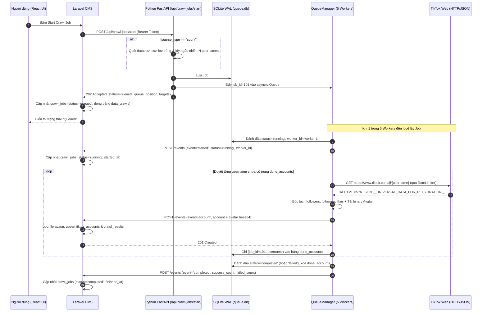

# TikTok Crawler Service — Tài liệu Kiến trúc & Vận hành

**TikTok Crawler Service** (`tiktok-crawler-service`) là microservice Python độc lập (FastAPI + AsyncIO) chịu trách nhiệm thu thập dữ liệu hồ sơ TikTok qua giao thức HTTP/JSON, quản lý hàng đợi thực thi bền vững (SQLite WAL), điều phối Worker Pool cố định và đồng bộ kết quả theo thời gian thực về hệ thống quản trị Laravel CMS.

---

## 1. Tổng quan Năng lực & Tính năng Hỗ trợ

| Nhóm tính năng | Mô tả chi tiết khả năng hỗ trợ |
| :--- | :--- |
| **HTTP JSON Crawler (Không dùng trình duyệt)** | Sử dụng `httpx.AsyncClient` kết hợp `BeautifulSoup4` để tải HTML trang profile TikTok và trích xuất trực tiếp dữ liệu JSON nhúng (`__UNIVERSAL_DATA_FOR_REHYDRATION__`, `SIGI_STATE`, hoặc fallback DOM meta). Tiêu thụ rất ít RAM (~50–80MB cho toàn bộ tiến trình thay vì hàng GB như Chromium/Playwright). |
| **Hàng đợi nội bộ trên Python (`SQLite WAL` + `asyncio.Queue`)** | Cho phép **200+ người dùng bấm Start cùng lúc** mà không bị nghẽn hay từ chối dịch vụ. Toàn bộ job được ghi bền vững vào `data/queue.db` trước khi trả `202 Accepted` trong vài mili-giây. |
| **Fixed Worker Pool (`WORKER_COUNT = 5`)** | Khởi tạo cố định `N` workers (mặc định `5`) một lần duy nhất khi bật service. Không bao giờ tạo mới worker hay trình duyệt theo từng request. Tối đa 5 jobs chạy song song; các job còn lại xếp hàng FIFO. |
| **3 Chế độ Nguồn dữ liệu (`usernames`, `urls`, `count`)** | - `usernames`: Crawl theo danh sách username chỉ định.<br>- `urls`: Tự động chuẩn hóa URL TikTok về username để crawl.<br>- `count`: Tự động quét toàn bộ file `.csv` / `.txt` trong thư mục `dataset/`, lọc trùng đa cấu trúc cột (`username`, `account_id`, `url`...), lấy mẫu ngẫu nhiên `total_accounts` và **đóng băng (freeze)** danh sách mục tiêu. |
| **Streaming Kết quả từng Account** | Không đợi chạy xong cả job mới trả kết quả. Ngay khi crawl xong **1 account**, worker lập tức gửi webhook `event = "account"` về Laravel để cập nhật UI/DB theo thời gian thực và đánh dấu checkpoint. |
| **Tải Avatar về Local & Lưu Path (`avatar_url = null`)** | Tự động tải ảnh đại diện về bộ nhớ đệm (`<= 2MB`), kiểm tra chữ ký định dạng ảnh thật (magic bytes JPEG/PNG/WEBP/GIF), mã hóa `base64` truyền về Laravel để lưu file vào `public/tiktok-accounts/avatars/{username}.{ext}` và chỉ lưu `avatar_path` vào DB. |
| **Phục hồi sau Crash 2 tầng (Crash Recovery)** | - **Tầng 1 (SQLite còn dữ liệu)**: Khi khởi động lại, tự động nạp các job `running` bị đứt quãng lên đầu hàng đợi (`resume_count + 1`), tiếp theo là các job `queued` theo thứ tự FIFO, và **bỏ qua toàn bộ các account đã xong (`done_accounts`)**.<br>- **Tầng 2 (Mất file SQLite khi redeploy container)**: Tự động gọi API `GET /crawler/jobs/unfinished` của Laravel để khôi phục lại các job đang dang dở. |
| **Bảo vệ & Ổn định Hệ thống** | Tích hợp sẵn **Global Rate Limiter** (giới hạn tốc độ request + độ trễ ngẫu nhiên jitter), **Global Circuit Breaker** (tự động tạm nghỉ toàn bộ workers khi gặp 5 lỗi `429`/`CHALLENGE` liên tiếp), **Per-Account Timeout** (`90s`/account) và **Worker Supervisor** (tự hồi sinh worker nếu gặp lỗi ngoài dự kiến). |

---

## 2. Cấu trúc Thư mục & Trách nhiệm từng Module

```text
tiktok-crawler-service/
├── app/
│   ├── __init__.py
│   ├── main.py                      # Điểm khởi chạy Uvicorn server (HOST, PORT)
│   ├── api/                         # Tầng giao tiếp HTTP / FastAPI
│   │   ├── __init__.py
│   │   └── routes.py                # FastAPI endpoints, Lifespan khởi tạo QueueManager & Bearer Auth
│   ├── core/                        # Cấu hình hệ thống & Tiện ích dùng chung
│   │   ├── __init__.py
│   │   ├── config.py                # Quản lý toàn bộ biến môi trường (.env) & đường dẫn hệ thống
│   │   └── utils.py                 # Chuẩn hóa username, URL và parse_stat_value
│   ├── schemas/                     # Tầng dữ liệu (Pydantic Models)
│   │   ├── __init__.py
│   │   └── models.py                # TikTokAccount, AvatarPayload, AccountCrawlOutcome, CrawlJobRecord
│   ├── crawler/                     # Tầng thu thập & phân tích dữ liệu TikTok
│   │   ├── __init__.py
│   │   ├── tiktok_client.py         # HTTP Client gọi TikTok, RateLimiter, CircuitBreaker, Retry 5xx
│   │   ├── extractor.py             # Bộ bóc tách JSON (__UNIVERSAL_DATA_FOR_REHYDRATION__, SIGI_STATE, OpenGraph)
│   │   └── avatar.py                # Tải binary avatar, kiểm tra magic bytes, giới hạn 2MB, base64
│   ├── engine/                      # Tầng điều phối Hàng đợi & Worker Pool
│   │   ├── __init__.py
│   │   ├── queue_manager.py         # Quản lý asyncio.Queue, Pool 5 Workers, Supervisor & Crash Recovery
│   │   ├── job_runner.py            # Vòng lặp thực thi 1 Job: duyệt từng account, timeout, logging & gửi webhook
│   │   └── store.py                 # SQLite WAL Store (bảng jobs và done_accounts)
│   └── services/                    # Các dịch vụ tích hợp (Dataset & Laravel Webhook)
│       ├── __init__.py
│       ├── dataset.py               # Đọc đa định dạng CSV/TXT trong datasets/ (fallback example.csv)
│       └── laravel_client.py        # HTTP Client gửi webhook (started, account, completed) về Laravel
├── datasets/                        # Thư mục duy nhất chứa các file CSV/TXT dữ liệu cho chế độ 'count'
│   ├── dataset-1.csv                # Hỗ trợ cột 'username'
│   ├── dataset-2.csv                # Hỗ trợ cột 'account_id' / 'url'
│   └── example.csv                  # File dữ liệu mẫu fallback khi chưa có dataset-1.csv / dataset-2.csv
├── data/                            # Tự động sinh lúc chạy: chứa queue.db, queue.db-wal, queue.db-shm
├── tests/                           # Bộ kiểm thử tự động (Unit & Integration Tests)
│   ├── fixtures/                    # Dữ liệu mẫu HTML TikTok (ok, sigi, private, not_found, challenge)
│   ├── test_extractor.py            # Kiểm thử bóc tách JSON & xử lý tràn số 32-bit
│   ├── test_dataset.py              # Kiểm thử đọc nhiều file CSV khác schema & lọc trùng
│   ├── test_store.py                # Kiểm thử SQLite WAL, chống trùng job_id & thứ tự khôi phục
│   ├── test_tiktok_client.py        # Kiểm thử retry 5xx, không retry 404, và mở Circuit Breaker
│   └── test_queue_manager.py        # Kiểm thử 200 jobs đồng thời trên 5 workers & Crash Recovery
├── requirements.txt                 # Danh sách thư viện Python
├── .env.example                     # Mẫu cấu hình biến môi trường
└── README.md                        # Tài liệu hướng dẫn này
```

---

## 3. Luồng Hoạt động Chi tiết (Workflows)

### 3.1. Sơ đồ Tổng thể Luồng Xử lý Job



### 3.2. Luồng 1: Tiếp nhận Job & Đóng băng Dữ liệu (`Enqueue Flow`)
1. Khi nhận request `POST /api/crawl-jobs/start`:
   - Kiểm tra `Authorization: Bearer <CRAWLER_TOKEN>` (nếu có cấu hình `CRAWLER_TOKEN`).
   - Kiểm tra dung lượng hàng đợi (`MAX_QUEUE_SIZE = 1000`). Nếu đầy trả `429 Too Many Requests`.
2. Chuẩn hóa danh sách mục tiêu (`targets`):
   - Nếu `source_type = "usernames"` hoặc `"urls"`: chuẩn hóa toàn bộ URL/username về dạng username sạch (bỏ `@`, chữ thường) và loại bỏ trùng lặp.
   - Nếu `source_type = "count"`: `DatasetLoader` đọc toàn bộ file `.csv`/`.txt` trong thư mục `dataset/` (hỗ trợ cả phân tách `,`, `;`, `\t`), tự động nhận diện cột chứa username (`username`, `account_id`, `user_name`, `handle`) hoặc trích xuất từ cột `url` (`https://www.tiktok.com/@...`), loại bỏ giá trị số thuần túy (như TikTok numeric ID 19 chữ số), lọc trùng toàn cục và lấy ngẫu nhiên đúng `total_accounts`.
3. Ghi bền vững vào bảng `jobs` trong `data/queue.db` (SQLite WAL) và đẩy `job_id` vào `asyncio.Queue`.
4. Trả về `202 Accepted` ngay lập tức kèm mảng `targets` đã đóng băng để Laravel lưu lại vào cột `data_crawls`. Nhờ đó, nếu job cần resume hoặc retry sau này, hệ thống sẽ crawl đúng tập tài khoản đã chọn ban đầu.

### 3.3. Luồng 2: Thực thi từng Account & Xử lý Avatar (`Worker Execution Flow`)
1. Một worker rảnh trong 5 workers cố định (`worker-1` .. `worker-5`) lấy `job_id` từ hàng đợi.
2. Worker kiểm tra bảng `done_accounts` trong SQLite để lọc ra danh sách các username **chưa được xử lý** (`pending_targets = targets - done_accounts`).
3. Với mỗi `username`, worker bọc lời gọi trong `asyncio.wait_for(..., timeout=90s)`:
   - Đi qua **Circuit Breaker** (nếu đang mở do TikTok chặn hàng loạt thì worker tự động ngủ chờ hết thời gian cooldown) và **Rate Limiter** (đảm bảo tốc độ tối đa `RATE_LIMIT_PER_SEC` + jitter ngẫu nhiên).
   - Tải trang `https://www.tiktok.com/@{username}` và trích xuất dữ liệu từ JSON:
     - `followers`: `stats.followerCount`
     - `following`: `stats.followingCount`
     - `likes`: `stats.heartCount` / `stats.heart` (tự động cộng bù `2^32` nếu TikTok trả số âm do lỗi tràn số nguyên 32-bit có dấu trên các kênh > 2.14 tỷ tim).
   - Nếu trích xuất thành công và có URL ảnh đại diện trong JSON:
     - `AvatarDownloader` tải dữ liệu nhị phân của ảnh (`<= 2MB`), kiểm tra byte đầu tiên (magic bytes) để xác thực đúng ảnh `JPEG`, `PNG`, `WEBP` hoặc `GIF`.
     - Chuyển thành chuỗi `base64` đính kèm vào trường `avatar` của webhook payload, đồng thời đặt `avatar_url = None` (tuyệt đối không lưu link CDN TikTok có thời hạn vào database).
4. Worker gửi webhook `event = "account"` về Laravel:
   - **Chỉ khi Laravel trả về HTTP 2xx**, worker mới ghi `(job_id, username)` vào bảng `done_accounts` trong SQLite.
   - Nếu Laravel đang bảo trì/quá tải (HTTP 5xx hoặc mất kết nối sau 3 lần thử), worker **không** ghi `done_accounts`, đưa job về lại trạng thái `queued` và hẹn chạy lại sau `60 giây` để không mất dữ liệu.

### 3.4. Luồng 3: Khôi phục Tự động sau Sự cố (`Crash Recovery Flow`)
Khi tiến trình Python khởi động (hoặc tự động khởi động lại sau khi crash/mất điện):
1. **Khôi phục từ SQLite (`data/queue.db`)**:
   - Tìm tất cả job có `status IN ('running', 'queued')`.
   - Sắp xếp ưu tiên các job đang `running` dở lên trước (tăng `resume_count + 1`), tiếp theo là các job `queued` theo thứ tự thời gian `(queued_at ASC, job_id ASC)`.
   - Nếu một job có `resume_count > MAX_JOB_RESUMES` (mặc định `3` lần crash liên tiếp), hệ thống tự động đánh dấu job đó là `failed` và báo về Laravel để tránh vòng lặp crash vô tận.
2. **Khôi phục dự phòng từ Laravel (nếu mất file SQLite)**:
   - Nếu bảng `jobs` trong SQLite trống (ví dụ khi redeploy container không gắn ổ đĩa lưu trữ), service tự động gọi `GET /admin/api/public/crawler/jobs/unfinished` sang Laravel.
   - Nhận lại danh sách các job đang `running`/`queued` cùng `targets` và `done_accounts` từ bảng `crawl_results` của MySQL, tái tạo lại trạng thái trong SQLite và tiếp tục chạy từ tài khoản tiếp theo.

---

## 4. Cơ chế Phân loại Lỗi & Chính sách Retry

| Mã lỗi (`error_code`) | Nguyên nhân | Hành vi của Crawler |
| :--- | :--- | :--- |
| **`NOT_FOUND`** | HTTP 404 hoặc TikTok trả `statusCode = 10202 / 10221` (tài khoản không tồn tại/đã xóa). | **Không retry**. Ghi nhận kết quả `failed` cho account đó và chuyển sang account tiếp theo ngay. |
| **`PRIVATE`** | Tài khoản để chế độ riêng tư (`privateAccount = true`). | Vẫn lấy các chỉ số công khai (`followers`, `following`, `likes`, `avatar`) và đánh dấu thành công nếu trích xuất được. |
| **`CHALLENGE` / `HTTP_429`** | TikTok yêu cầu giải Captcha (`verifyFp` / `waf`) hoặc giới hạn tần suất (HTTP 429). | Tăng bộ đếm **Circuit Breaker**. Nếu xảy ra **5 lần liên tiếp**, toàn bộ 5 workers sẽ tạm dừng trong `CIRCUIT_BREAKER_COOLDOWN` (`300s`) trước khi chạy tiếp. |
| **`HTTP_5XX` / `NETWORK_ERROR`** | Lỗi mạng tạm thời hoặc máy chủ TikTok trả 500/502/503/504. | Tự động **retry tối đa `MAX_RETRIES` (3 lần)** với thời gian chờ tăng dần theo cấp số nhân (exponential backoff). |
| **`TIMEOUT`** | Quá thời gian xử lý tối đa cho 1 account (`ACCOUNT_TIMEOUT = 90s`). | Hủy tác vụ của account bị treo, ghi nhận lỗi `TIMEOUT`, giải phóng worker để xử lý account kế tiếp. |
| **`PARSE_ERROR`** | TikTok thay đổi cấu trúc HTML/JSON khiến không tìm thấy `userInfo`. | Ghi log danh sách các keys cấp cao nhất của JSON để phục vụ cập nhật parser, đánh dấu account `failed`. |

---

## 5. Đặc tả API & Webhook Giao tiếp

### 5.1. Các Endpoint của Python Service

| Phương thức | Endpoint | Mô tả |
| :--- | :--- | :--- |
| `GET` | `/health` | Kiểm tra trạng thái sống của service, số lượng workers đang sống, kích thước hàng đợi và số lượng tài khoản trong dataset. |
| `GET` | `/api/queue` | Xem chi tiết hàng đợi hiện tại: số job đang `queued`, danh sách job đang `running`, trạng thái Circuit Breaker. |
| `POST` | `/api/crawl-jobs/start` | (Alias: `/api/crawl-jobs`) Đẩy một job mới vào hàng đợi. Trả về `202 Accepted` kèm `queue_position` và `targets`. |
| `GET` | `/api/crawl-jobs/{job_id}` | Tra cứu trạng thái chi tiết và tiến độ (`done_accounts`) của một job trong SQLite. |
| `DELETE` | `/api/crawl-jobs/{job_id}` | Hủy một job đang nằm chờ trong hàng đợi (`queued`). Trả về `409 Conflict` nếu job đang `running`. |

#### Ví dụ Request `POST /api/crawl-jobs/start`:
```json
{
  "job_id": 42,
  "source_type": "count",
  "total_accounts": 100
}
```
#### Ví dụ Response `202 Accepted`:
```json
{
  "status": "queued",
  "job_id": 42,
  "queue_position": 1,
  "active_workers": 2,
  "worker_count": 5,
  "total_accounts": 100,
  "targets": ["khaby.lame", "charlidamelio", "..."]
}
```

### 5.2. Các Webhook Events gửi về Laravel (`POST /admin/api/public/crawler/crawl-jobs/{jobId}/events`)

1. **Khi Worker bắt đầu nhận Job (`event = "started"`)**:
   ```json
   {
     "event": "started",
     "job_id": 42,
     "status": "running",
     "worker_id": "worker-1",
     "resumed": false
   }
   ```
2. **Khi xử lý xong từng Account (`event = "account"`)**:
   ```json
   {
     "event": "account",
     "job_id": 42,
     "status": "success",
     "account": {
       "username": "khaby.lame",
       "followers": 162500000,
       "following": 78,
       "likes": 2500000000,
       "profile_url": "https://www.tiktok.com/@khaby.lame",
       "avatar_url": null,
       "avatar_path": null,
       "status": "active",
       "crawled_at": "2026-10-30T11:30:00",
       "last_crawled_at": "2026-10-30T11:30:00"
     },
     "avatar": {
       "content_base64": "/9j/4AAQSkZJRgABAQAAAQABAAD...",
       "mime": "image/jpeg"
     }
   }
   ```
3. **Khi hoàn tất toàn bộ Job (`event = "completed"`)**:
   ```json
   {
     "event": "completed",
     "job_id": 42,
     "status": "completed",
     "total_accounts": 100,
     "success_count": 98,
     "failed_count": 2,
     "error_message": null
   }
   ```

---

## 6. Cấu hình Biến Môi trường (`.env`)

Sao chép `.env.example` thành `.env` và tùy chỉnh các thông số theo nhu cầu vận hành:

| Biến môi trường | Mặc định | Ý nghĩa |
| :--- | :--- | :--- |
| `HOST` / `PORT` | `0.0.0.0` / `8001` | Địa chỉ IP và cổng lắng nghe của FastAPI server. |
| `LARAVEL_API_URL` | `http://127.0.0.1:8000/admin/api/public` | URL gốc của Laravel API để gửi webhook và lấy danh sách job chưa hoàn tất. |
| `CRAWLER_TOKEN` | *(trống)* | Mã bí mật xác thực hai chiều (`Authorization: Bearer <token>`) giữa Laravel và Python. |
| `WORKER_COUNT` | `5` | Số lượng workers cố định chạy song song. |
| `MAX_QUEUE_SIZE` | `1000` | Số lượng job tối đa cho phép nằm chờ trong hàng đợi. |
| `QUEUE_DB_PATH` | `data/queue.db` | Đường dẫn file SQLite lưu trạng thái hàng đợi và checkpoint. |
| `DATASETS_DIR` | *(tự nhận diện `dataset/`)* | Thư mục chứa các file `.csv` / `.txt` cho chế độ `count`. |
| `REQUEST_TIMEOUT` | `20` | Thời gian chờ tối đa (giây) cho mỗi HTTP request tới TikTok hoặc Laravel. |
| `ACCOUNT_TIMEOUT` | `90` | Thời gian tối đa (giây) cho toàn bộ quá trình xử lý 1 tài khoản (gồm cả retry & tải avatar). |
| `MAX_RETRIES` | `3` | Số lần thử lại tối đa khi gặp lỗi mạng hoặc HTTP 5xx. |
| `MAX_JOB_RESUMES` | `3` | Số lần tối đa một job được phép khôi phục sau khi tiến trình crash. |
| `RATE_LIMIT_PER_SEC` | `2.0` | Số lượng request tối đa gửi tới TikTok mỗi giây trên toàn bộ các workers. |
| `REQUEST_DELAY_MIN` / `MAX` | `0.8` / `2.0` | Khoảng thời gian nghỉ ngẫu nhiên (jitter, tính bằng giây) trước mỗi request tới TikTok. |
| `CIRCUIT_BREAKER_THRESHOLD` | `5` | Số lần gặp lỗi `429` hoặc `CHALLENGE` liên tiếp trước khi kích hoạt tạm nghỉ toàn cục. |
| `CIRCUIT_BREAKER_COOLDOWN` | `300` | Thời gian tạm nghỉ (giây) của toàn bộ workers khi Circuit Breaker mở. |
| `AVATAR_MAX_BYTES` | `2097152` (2MB) | Dung lượng tối đa cho phép khi tải ảnh đại diện. |

---

## 7. Hướng dẫn Cài đặt, Khởi chạy & Kiểm thử

### 7.1. Cài đặt và Khởi chạy Local
```bash
cd tiktok-crawler-service
pip install -r requirements.txt
cp .env.example .env
python app/main.py
```

### 7.2. Chạy Bộ Kiểm thử Tự động (Unit & Integration Tests)
```bash
cd tiktok-crawler-service
python -m unittest discover -s tests -p "test_*.py" -v
```
Bộ kiểm thử bao gồm **15 kịch bản tự động**:
- Bóc tách dữ liệu từ `__UNIVERSAL_DATA_FOR_REHYDRATION__` và `SIGI_STATE`, xử lý tràn số nguyên 32-bit âm cho `likes`.
- Nhận diện tài khoản `PRIVATE`, `NOT_FOUND` (404 / 10202) và `CHALLENGE` (Captcha).
- Đọc nhiều file CSV có cấu trúc cột khác nhau (`username`, `account_id`, `url`), lọc bỏ ID số và khử trùng lặp.
- Đẩy đồng thời **200 jobs** vào hàng đợi với **5 workers cố định** (đảm bảo không bao giờ vượt quá 5 jobs chạy cùng lúc).
- Khôi phục sau sự cố (Crash Recovery) từ SQLite (bỏ qua `done_accounts`) và khôi phục dự phòng từ API `/crawler/jobs/unfinished` của Laravel.
- Xử lý timeout từng account, retry khi Laravel mất kết nối tạm thời và kích hoạt Circuit Breaker.
