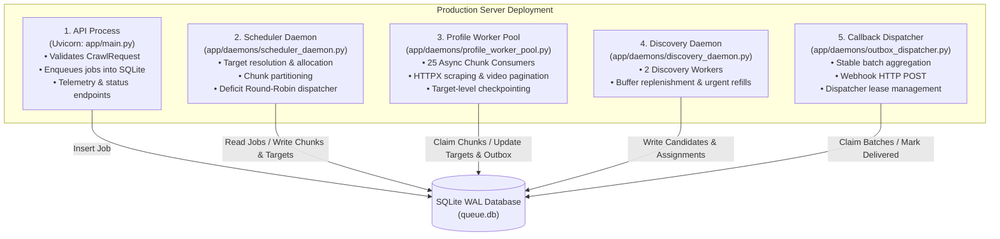
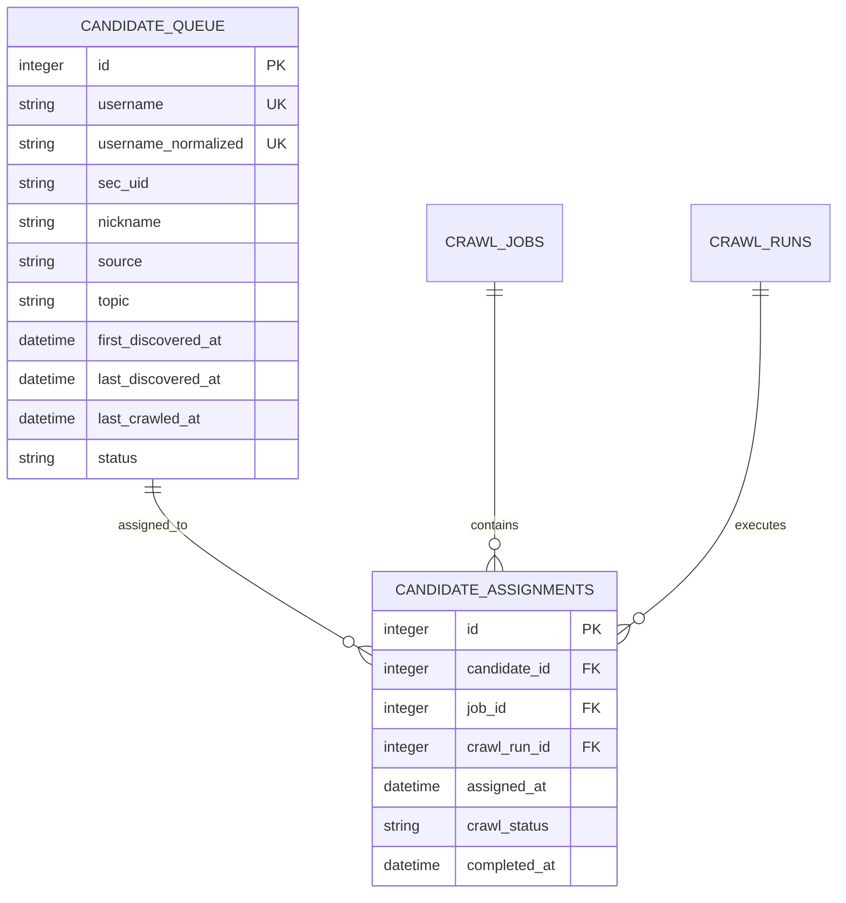
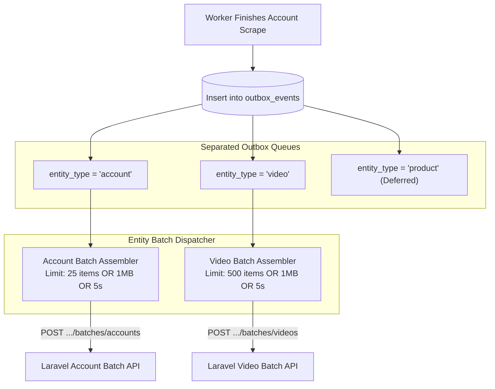
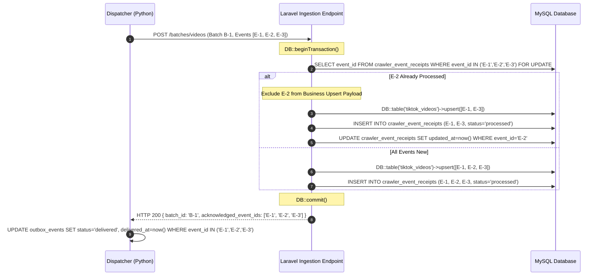
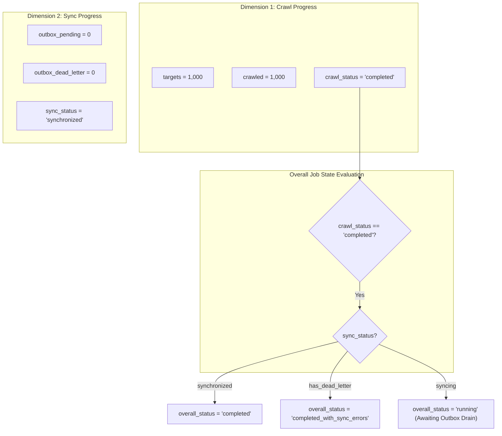

# Architecture Specification: High-Concurrency TikTok Crawler with Entity-Based Durable Batch Webhooks

> **Document Status**: Final Architecture Specification (Planning Mode Only)  
> **Target Workload**: 100 Concurrent Users $\times$ up to 1,000 Accounts per Job ($100,000$ Accounts Total)  
> **Core Pillars**: Decoupled Process Daemon Roles, Persistent Deficit Round-Robin Scheduling, Target-Level Execution Checkpointing, Dimensionally Correct Throughput Modeling, Candidate Assignment History, Entity-Based Batch Webhooks, Durable Outbox with Stable Batch Leases, Laravel Event Receipts, Crawl Run Snapshots, and Dual-Dimension Progress Tracking.  
> **Scope**: Architecture Documentation Only — Zero Source Code / Migration Modifications.

---

## 1. Executive Summary

This specification establishes the production architecture for the high-concurrency TikTok Crawler Service and its integration with Laravel 13 CMS. The system is designed to reliably ingest **100 concurrent jobs of up to 1,000 accounts each ($100,000$ accounts total)** without browser-based rendering, without SQLite database corruption, without violating provider quotas, and with **provable at-least-once delivery and end-to-end idempotency**.

### Core Architecture Pillars
1. **Zero Frontend Dependency**: The React 19 CMS UI and REST API request contracts (`POST /api/crawl-jobs` with `source_type="count"`, `total_accounts=N`) remain 100% backward-compatible. All hybrid allocations, chunk partitioning, fair scheduling, and batch dispatching execute autonomously in the backend.
2. **Decoupled Process Roles**: Five dedicated, single-responsibility process daemons (API Ingress, Scheduler Daemon, Profile Worker Pool, Discovery Daemon, and Callback Dispatcher) eliminate multi-process lock contention and worker multiplication.
3. **Deficit Round-Robin & Target-Level Checkpointing**: Jobs are partitioned into discrete chunks ($25$ accounts/chunk), with individual accounts tracked in a persistent `crawl_job_targets` table. Workers claim chunks via Deficit Round-Robin (DRR). Interrupted chunks re-execute only uncompleted targets, avoiding duplicate scraping.
4. **Dimensionally Correct Throughput Modeling**: Replaces conflated concurrency assumptions with a dimensionally accurate steady-state rate model:
   $$\text{RPS}_{\text{effective}} = \min\left(\frac{C}{L}, \text{RPS}_{\text{limit}}\right), \quad \text{Accounts/sec} = \frac{\text{RPS}_{\text{effective}}}{\text{Requests/account}}$$
5. **Separation of Candidate Identity & Assignment History**: `candidate_queue` represents unique discovery identity, while `candidate_assignments` tracks multi-job assignment history. This enables cross-job reuse without global lockouts.
6. **Entity-Based Batch Webhooks with Stable Membership**: Outbound webhooks are partitioned by entity type (**Account Batch**, **Video Batch**, and forward-compatible **Product Batch**), strictly enforcing both record count and a $1\text{MB}$ payload ceiling. Batch event membership is persisted to guarantee deterministic retries.
7. **Durable Outbox & Laravel Event Receipts**: Outbox events are leased atomically by dispatchers. Laravel enforces deduplication via persistent `crawler_event_receipts` in MySQL, ensuring duplicate network deliveries return immediate success without executing redundant database updates.
8. **Historical Crawl Run Snapshots**: Introducing `crawl_run_id` decouples mutable master entities from immutable job snapshots, preserving time-series metric deltas across repeated crawl executions.

---

## 2. Current Implementation vs. Proposed Architecture

| Architectural Component | Existing Implementation (Verified in Codebase) | Status in Revised Plan | Classification |
|---|---|---|---|
| **Frontend Contract** | `CrawlJobFormPage.tsx` submits `source_type`, `total_accounts`, `usernames`, `urls`. | Preserved 100% without changes. | **Existing & Preserved** |
| **Worker Model** | `QueueManager` spawns a single fixed pool of 5 sequential workers in FastAPI lifespan. | Replaced by decoupled process entry points and 25 async consumers. | **Proposed Modification** |
| **Job Execution** | 1 Worker locks 1 Job for all targets sequentially (`job_runner.py`). | Replaced by Deficit Round-Robin Fair Chunk Scheduling ($25$ accounts/chunk). | **Proposed Modification** |
| **Target Checkpointing** | `done_accounts` table records `(job_id, username)`. Whole job requeues on failure. | Replaced by granular `crawl_job_targets` tracking per-account status. | **Proposed Modification** |
| **Candidate Sourcing** | `DatasetLoader` reads static CSV/TXT files from `datasets/`. | Augmented by SQLite `candidate_queue`, `candidate_assignments`, and live HTTP Discovery. | **Proposed Modification** |
| **Discovery Workers** | None. Discovery is static or non-existent. | Independent 2-worker Discovery daemon with 1,600/2,000 buffer watermarks. | **Proposed Addition** |
| **HTTP Crawling** | `TikTokClient` using `httpx.AsyncClient` with `RateLimiter` & `CircuitBreaker`. | Preserved; wrapped with explicit concurrency semaphores. | **Existing & Extended** |
| **Supported Entities** | Profile metadata, avatars (Base64), and videos (`TikTokVideo`). | Preserved; Product entity is deferred to future extension (Batch 8). | **Existing & Scoped** |
| **Avatar Storage** | In-memory Base64 string transmitted in single callback payload. | Replaced by direct filesystem volume mount / object store path. | **Proposed Modification** |
| **Callback Ingestion** | Monolithic single-account webhook (`POST .../events`). | Replaced by Entity-Based Batch Webhooks (`/batches/{entity}`). | **Proposed Modification** |
| **Outbox Durability** | In-memory retry loop (5 attempts) in `laravel_client.py`. | Replaced by persistent SQLite `outbox_events` and stable batch leases. | **Proposed Addition** |
| **Receipt Idempotency** | Partial `updateOrCreate` in Laravel `CrawlResultService`. | Replaced by explicit `crawler_event_receipts` table in MySQL. | **Proposed Addition** |
| **Database Engines** | Python: SQLite WAL (`queue.db`). Laravel: MySQL 8 (Docker). | Preserved with strict SQLite WAL concurrency and multi-host rules. | **Existing & Preserved** |

---

## 3. Worker Process Architecture

In production, running background schedulers, worker pools, and discovery loops inside multiple Uvicorn worker processes causes duplicate worker initialization, competing thread locks, and SQLite write storms.

### 3.1. Process Decomposition (Production Mode)
The system is partitioned into five independent OS-level processes managed by Supervisor or systemd:



### 3.2. Process Ownership Matrix

| Process Name | Entrypoint | Primary Responsibilities | DB Access Mode |
|---|---|---|---|
| **API Server** | `app/main.py` | Ingress validation, job enqueueing, health checks. | Short writes (insert job), read-only queue queries. |
| **Chunk Scheduler** | `app/daemons/scheduler_daemon.py` | Maintains active job DRR deque, assigns chunks to ready state. | Periodic writes (insert chunks/targets, update job status). |
| **Profile Worker Pool** | `app/daemons/profile_worker_pool.py` | 25 async consumers claiming chunks, scraping profiles/videos, staging outbox events. | Transactional writes on target & chunk completion. |
| **Discovery Daemon** | `app/daemons/discovery_daemon.py` | Watermark polling, background discovery, urgent job refill execution. | Batch inserts into `candidate_queue`. |
| **Callback Dispatcher** | `app/daemons/outbox_dispatcher.py` | Stable batch assembly, lease acquisition, webhook HTTP delivery, payload cleanup. | High-frequency short updates on event status. |

*Development Mode Exception*: A unified single-process mode via FastAPI `lifespan` is retained for local development and unit testing only, where all tasks run as background coroutines under a single event loop.

---

## 4. Fair Chunk Scheduling & Target-Level Recovery

### 4.1. Scheduler Ownership vs. Chunk Store Ownership
To prevent race conditions and maintain architectural clarity:
- **Chunk Scheduler (`app/engine/chunk_scheduler.py`)**:
  - Maintains the active job queue, user-level quotas, and deficit counters in memory.
  - Determines *which* `job_id` earns the right to dispatch next using Deficit Round-Robin.
  - Advances scheduling state after a successful claim.
  - Restores deficit counters and active job lists upon daemon restart.
- **Chunk Store (`app/engine/chunk_store.py`)**:
  - Owns persistent chunk and target state in SQLite.
  - Executes atomic chunk claiming for a specific `job_id` requested by the scheduler.
  - Enforces lease validity and reclaims expired leases.
  - Profile Workers **never** independently query `ORDER BY job_id ASC`. Workers ask the Scheduler for work, and the Scheduler instructs Chunk Store to lease a chunk.

### 4.2. Implementable Deficit Round-Robin (DRR) Algorithm

```mermaid
flowchart TD
    Start["Worker Requests Next Chunk"] --> CheckActive{"Active Job Queue Empty?"}
    CheckActive -->|Yes| Sleep["Wait for New Jobs / Chunks"]
    CheckActive -->|No| PickHead["Select Head Job from Deque (Job J)"]
    
    PickHead --> AddQuantum["Add Quantum to Deficit: D_J = D_J + Quantum"]
    AddQuantum --> CheckCost{"Deficit >= Chunk Cost?<br/>(D_J >= Cost_Chunk)"}
    
    CheckCost -->|No| NextJob["Rotate Job J to Tail of Queue<br/>Pick Next Head Job"]
    NextJob --> PickHead
    
    CheckCost -->|Yes| ClaimChunk["ChunkStore: Atomically Lease Next Queued Chunk for Job J"]
    ClaimChunk --> ClaimSuccess{"Chunk Leased Successfully?"}
    
    ClaimSuccess -->|Yes| Deduct["Deduct Cost: D_J = D_J - Cost_Chunk<br/>Dispatch Chunk to Worker"]
    ClaimSuccess -->|No (No Chunks Left)| RemoveJob["Remove Job J from Active Queue<br/>Reset D_J = 0"]
    RemoveJob --> PickHead
```

#### DRR Mathematical Model & Pseudocode
- **Parameters**:
  - $\text{Quantum} = 25$ (credits added per rotation cycle).
  - $\text{Cost}_{\text{chunk}} = 25$ (credit cost to dispatch a 25-account chunk).
  - $\text{Deficit}_j$ = Deficit counter for Job $j$ (initialized to $0$).
- **Algorithm Execution**:
  ```python
  class DeficitRoundRobinScheduler:
      def __init__(self, quantum: int = 25, chunk_cost: int = 25):
          self.quantum = quantum
          self.chunk_cost = chunk_cost
          self.active_jobs: collections.deque[int] = collections.deque()
          self.deficits: dict[int, int] = {}

      async def get_next_chunk(self, worker_id: str) -> ChunkRecord | None:
          while self.active_jobs:
              job_id = self.active_jobs[0]
              self.deficits[job_id] = self.deficits.get(job_id, 0) + self.quantum

              if self.deficits[job_id] >= self.chunk_cost:
                  chunk = await chunk_store.lease_next_chunk(job_id, worker_id)
                  if chunk:
                      self.deficits[job_id] -= self.chunk_cost
                      # Rotate to tail if job still has remaining chunks
                      if await chunk_store.has_pending_chunks(job_id):
                          self.active_jobs.rotate(-1)
                      else:
                          self.active_jobs.popleft()
                          self.deficits.pop(job_id, None)
                      return chunk
                  else:
                      # Job has no queued chunks; remove from active rotation
                      self.active_jobs.popleft()
                      self.deficits.pop(job_id, None)
              else:
                  # Insufficient deficit; rotate to tail
                  self.active_jobs.rotate(-1)
          return None
  ```

### 4.3. Target-Level Execution Checkpointing (`crawl_job_targets`)
To prevent re-crawling an entire 25-account chunk if a worker crashes after processing 15 accounts, execution state is recorded at the individual target level.

```sql
CREATE TABLE IF NOT EXISTS crawl_job_targets (
    id                  INTEGER PRIMARY KEY AUTOINCREMENT,
    job_id              INTEGER NOT NULL,
    crawl_run_id        INTEGER NOT NULL,
    chunk_id            INTEGER NOT NULL,
    username            TEXT NOT NULL,
    target_type         TEXT NOT NULL DEFAULT 'new_candidate', -- 'historical' or 'new_candidate'
    status              TEXT NOT NULL DEFAULT 'pending',       -- 'pending', 'running', 'completed', 'failed'
    attempts            INTEGER NOT NULL DEFAULT 0,
    assigned_at         TEXT NOT NULL,
    started_at          TEXT,
    completed_at        TEXT,
    error_message       TEXT,
    UNIQUE(job_id, crawl_run_id, username),
    FOREIGN KEY(chunk_id) REFERENCES job_chunks(chunk_id) ON DELETE CASCADE
);
CREATE INDEX IF NOT EXISTS idx_targets_chunk ON crawl_job_targets(chunk_id, status);
CREATE INDEX IF NOT EXISTS idx_targets_job ON crawl_job_targets(job_id, crawl_run_id, status);
```

#### Chunk Execution & Recovery Protocol:
1. When a worker receives a chunk, it queries:
   ```sql
   SELECT username FROM crawl_job_targets
   WHERE chunk_id = :chunk_id AND status != 'completed';
   ```
2. Any targets marked `completed` are skipped immediately.
3. As each account finishes scraping, the worker executes a single local transaction:
   - Updates `crawl_job_targets` $\rightarrow$ `status = 'completed'`, `completed_at = now`.
   - Inserts account and video records into SQLite outbox.
4. **Chunk Completion Condition**: A chunk is marked `completed` in `job_chunks` if and only if **all** associated targets in `crawl_job_targets` are in a terminal state (`completed` or `failed`).
5. **Crash Recovery**: If a worker crashes midway, the chunk lease expires. The next worker claiming the chunk inspects `crawl_job_targets`, automatically resumes from the 16th account, and never re-scrapes the first 15.

### 4.4. Admission Controls vs. Persisted Capacities
The architecture resolves potential contradictions between queue and job limits:
- **`MAX_PENDING_CHUNKS = 4000`**: Refers strictly to the **SQLite database persistence ceiling** ($4,000\text{ chunks} \times 25\text{ accounts} = 100,000\text{ accounts}$). The system can safely store 4,000 chunks on disk without loading them into memory.
- **`MAX_ACTIVE_JOBS = 100`**: Maximum number of concurrent jobs actively maintained in the DRR in-memory scheduler deque.
- **`MAX_ACCOUNTS_PER_JOB = 1000`**: Maximum target limit accepted per individual REST request.
- **In-Memory Buffer Ceiling**: The scheduler loads only $\le 100$ active chunk references in memory at any instant.

---

## 5. Async HTTP Concurrency & Dimensionally Correct Throughput

### 5.1. Dimensionally Correct Steady-State Throughput Formulation
The previous formulation incorrectly treated concurrency (a dimensionless count of active sockets) and request rate (requests per second) as interchangeable. The revised architecture enforces a mathematically sound steady-state model:

$$\text{RPS}_{\text{latency}} = \frac{C_{\text{net}}}{L_{\text{avg}}}$$

$$\text{RPS}_{\text{effective}} = \min\left(\text{RPS}_{\text{latency}}, \text{RPS}_{\text{limit}}\right)$$

$$\text{Throughput}_{\text{accounts/sec}} = \frac{\text{RPS}_{\text{effective}}}{\text{RequestsPerAccount}}$$

Where:
- $C_{\text{net}}$ = Effective active HTTP socket concurrency (governed by `MAX_CONCURRENT_REQUESTS = 30`).
- $L_{\text{avg}}$ = Measured average request round-trip latency in seconds ($L_{\text{avg}} \approx 0.25\text{s}$ assumed).
- $\text{RPS}_{\text{limit}}$ = Upstream provider allowed requests per second per domain.
- $\text{RequestsPerAccount}$ = Average HTTP requests required to fully collect an account:
  $$\text{RequestsPerAccount} = 1\text{ (Profile)} + 1\text{ (Avatar)} + \left\lceil \frac{V_{\text{target}}}{15} \right\rceil\text{ (Video Pagination)} + R_{\text{retry}}$$

#### Theoretical Steady-State Throughput Table (Benchmark Assumptions)

| Account Profile Target | Requests / Account | $\text{RPS}_{\text{latency}}$ ($C=30, L=0.25\text{s}$) | $\text{RPS}_{\text{limit}}$ (Domain Cap) | $\text{RPS}_{\text{effective}}$ | Est. Account Throughput | Est. Duration for 100k Accounts |
|---|---|---|---|---|---|---|
| **Profile Only (0 Videos)** | 2 requests | $120\text{ req/s}$ | $2.0\text{ req/s}$ | $2.0\text{ req/s}$ | $1.0\text{ accounts/s}$ | $\sim 27.7\text{ hours}$ |
| **20 Videos** | 4 requests | $120\text{ req/s}$ | $5.0\text{ req/s}$ | $5.0\text{ req/s}$ | $1.25\text{ accounts/s}$ | $\sim 22.2\text{ hours}$ |
| **100 Videos** | 9 requests | $120\text{ req/s}$ | $10.0\text{ req/s}$ | $10.0\text{ req/s}$ | $1.11\text{ accounts/s}$ | $\sim 25.0\text{ hours}$ |

> [!WARNING]
> **Assumption Qualification**: Real throughput is strictly constrained by upstream provider rate limits ($\text{RPS}_{\text{limit}}$), not by local CPU or socket concurrency. Without multiple legal provider credentials or higher approved API quotas, 100,000 accounts cannot physically be crawled in 41 minutes on a single IP. Batch 1 must establish the empirical baseline.

### 5.2. Provider and Endpoint-Specific Rate Limiting
- Upstream rate limits are configured and enforced per endpoint domain:
  - Profile Web Feed (`www.tiktok.com`): $\text{RPS}_{\text{limit}} = 2.0$, jitter delay $[0.6\text{s}, 1.2\text{s}]$.
  - Video API Feed (`api.tiktok.com`): $\text{RPS}_{\text{limit}} = 5.0$, jitter delay $[0.2\text{s}, 0.5\text{s}]$.
  - Research API (if authenticated): Follows official contractual quotas.
- **Cross-Process Rate Limiting**: An in-process `asyncio.Semaphore` only regulates sockets within a single Python process. To coordinate rate limits across multiple independent daemon processes without adding Redis in Phase 1:
  - All outbound network calls are isolated inside the **Profile Worker Pool process** (`profile_worker_pool.py`).
  - Discovery workers run on separate, dedicated domain endpoints with their own local token bucket.
  - If multi-host worker execution is deployed in the future, rate limiting coordinates via a centralized Redis token bucket.

---

## 6. Candidate Store & Assignment History

### 6.1. Separation of Identity from Assignment History
The previous design stored `status = 'claimed'` and `last_job_id` directly on `candidate_queue`. This prevented cross-job reuse because a candidate appeared permanently locked. The revised architecture strictly decouples **Candidate Identity** from **Job Assignment History**:



### 6.2. Schemas for Candidates and Multi-Job Assignments

```sql
-- Unique Candidate Identity & Discovery Metadata
CREATE TABLE IF NOT EXISTS candidate_queue (
    id                      INTEGER PRIMARY KEY AUTOINCREMENT,
    username                TEXT NOT NULL UNIQUE,
    username_normalized     TEXT NOT NULL UNIQUE,       -- Lowercased, stripped @
    sec_uid                 TEXT,
    nickname                TEXT,
    source                  TEXT NOT NULL,              -- 'explore', 'hashtag:#tech', 'dataset'
    topic                   TEXT,
    first_discovered_at     TEXT NOT NULL,
    last_discovered_at      TEXT NOT NULL,
    last_crawled_at         TEXT,
    status                  TEXT NOT NULL DEFAULT 'active', -- 'active', 'temp_unavailable', 'banned'
    created_at              TEXT NOT NULL,
    updated_at              TEXT NOT NULL
);
CREATE INDEX IF NOT EXISTS idx_candidates_source ON candidate_queue(source, status);

-- Per-Job Multi-Assignment History
CREATE TABLE IF NOT EXISTS candidate_assignments (
    id                  INTEGER PRIMARY KEY AUTOINCREMENT,
    candidate_id        INTEGER NOT NULL,
    job_id              INTEGER NOT NULL,
    crawl_run_id        INTEGER NOT NULL,
    assigned_at         TEXT NOT NULL,
    crawl_status        TEXT NOT NULL DEFAULT 'assigned', -- 'assigned', 'crawled', 'failed'
    completed_at        TEXT,
    UNIQUE(job_id, crawl_run_id, candidate_id),
    FOREIGN KEY(candidate_id) REFERENCES candidate_queue(id) ON DELETE CASCADE
);
CREATE INDEX IF NOT EXISTS idx_assignments_candidate ON candidate_assignments(candidate_id, assigned_at);
CREATE INDEX IF NOT EXISTS idx_assignments_job ON candidate_assignments(job_id, crawl_run_id);
```

### 6.3. Candidate Selection Priority Protocol
When Target Resolver claims candidates for Job $J$ (Crawl Run $R$):
1. **Priority 1 (Pure Fresh)**: Candidates where `last_crawled_at IS NULL` and `id NOT IN (SELECT candidate_id FROM candidate_assignments)`.
2. **Priority 2 (Never Crawled, Previously Assigned)**: Candidates where `last_crawled_at IS NULL` that were assigned to older jobs that never finished.
3. **Priority 3 (Least Recently Assigned / Crawled)**: Candidates sorted by `COALESCE(last_crawled_at, '1970-01-01') ASC`, provided `candidate_id NOT IN (SELECT candidate_id FROM candidate_assignments WHERE job_id = J)`.
4. **Hard Constraint**: A candidate can **never** be assigned twice to the same Job ($J$). Duplicate usernames within one job are forbidden.

---

## 7. Global Candidate Buffer & Job-Driven Discovery

### 7.1. Global Buffer Specifications
- **Watermark Settings**:
  ```ini
  DISCOVERY_BUFFER_LOW_WATERMARK=1600
  DISCOVERY_BUFFER_HIGH_WATERMARK=2000
  DISCOVERY_BATCH_SIZE=50
  DISCOVERY_INTERVAL_SECONDS=20.0
  ```
- The global buffer is a **shared supply reserve**, not a cap on total crawl capacity.
- Background discovery continuously replenishes `candidate_queue` up to 2,000 eligible fresh records.
- When available fresh candidates fall below 1,600, the Discovery Daemon wakes up to harvest batches of 50.

### 7.2. Fallback Policy & Shortage Handling (Corrected Scenario H)
If Job $J$ requests $N = 1,000$ accounts ($500$ historical + $500$ fresh), but discovery produces only $350$ fresh accounts and historical pool only contains $400$ accounts:
$$\text{Total Available Unique Targets} = 350 + 400 = 750 < 1,000$$
The system **does not silently promise 1,000 targets**. It executes an explicit fallback policy:
1. `ALLOW_HISTORICAL_FALLBACK = true`: System attempts to fulfill remaining targets from eligible historical accounts.
2. If total available unique candidates remain below $N$:
   - The Target Resolver allocates the verified $750$ targets to Chunks 0 through 29.
   - It updates `crawl_jobs.total_accounts = 750` in SQLite and Laravel.
   - It appends a detailed status message: `"Job initialized with 750 available unique targets (350 fresh, 400 historical) due to discovery pool depletion"`.
   - The job proceeds without crashing or entering infinite discovery retry loops.

---

## 8. Entity-Based Batch Webhooks

### 8.1. Independent Entity Pipelines
Account, Video, and Product records are decoupled into independent batch pipelines:



### 8.2. Stable Batch Grouping Keys & Sizing
- **Batch Grouping Key**: Every batch is strictly bound to `(job_id, crawl_run_id, entity_type)`. Events belonging to different jobs or runs are never intermixed.
- **Batch Sizing & Thresholds**:
  - **Account Batch**: $\le 25\text{ records}$, $\le 1,048,576\text{ bytes}$ ($1.0\text{ MB}$), flush interval $5.0\text{s}$.
  - **Video Batch**: $\le 500\text{ records}$, $\le 1,048,576\text{ bytes}$ ($1.0\text{ MB}$), flush interval $5.0\text{s}$.
  - **Product Batch** *(Phase 2)*: $\le 250\text{ records}$, $\le 1,048,576\text{ bytes}$ ($1.0\text{ MB}$), flush interval $5.0\text{s}$.

### 8.3. Parent-Child Delivery Ordering
- **Strict Dependency**: For any account $U$, its `outbox_events (entity='account')` must be confirmed as `status = 'delivered'` by Laravel **before** any dependent `outbox_events (entity='video')` for $U$ are leased for dispatch.
- **Partial Parent Success**: If an Account Batch of 25 records has 20 records acknowledged and 5 records rejected:
  - Only video records belonging to the 20 acknowledged accounts are unlocked for dispatch.
  - Video records belonging to the 5 unacknowledged accounts remain in `status = 'pending'`, awaiting parent resolution. No child records are discarded.

### 8.4. Oversized Record Handling
- The crawler **never silently truncates** description texts or omits metadata.
- If a single video record with extensive transcript/metadata exceeds $1\text{MB}$:
  1. It is flagged as `is_oversized = TRUE`.
  2. It is dispatched in an **isolated single-record batch**.
  3. If it exceeds web server HTTP request size limits ($10\text{MB}$), the raw payload is written to shared volume / object storage, and the webhook transmits a storage reference (`storage_ref: "large_payloads/event_uuid.json"`).

---

## 9. Durable Outbox, Cleanup & Laravel Event Receipts

### 9.1. Outbox Event Schema with Stable Batch Leases
To prevent dispatchers from recreating different random batches on retries, batch membership is locked:

```sql
CREATE TABLE IF NOT EXISTS outbox_events (
    event_id            TEXT PRIMARY KEY,           -- UUIDv4
    job_id              INTEGER NOT NULL,
    crawl_run_id        INTEGER NOT NULL,
    entity_type         TEXT NOT NULL,              -- 'account', 'video', 'product'
    entity_id           TEXT NOT NULL,              -- username, video_id
    payload_json        TEXT NOT NULL,
    status              TEXT NOT NULL DEFAULT 'pending', -- 'pending', 'leased', 'delivered', 'dead_letter'
    batch_id            TEXT,                       -- Stable batch identifier
    attempts            INTEGER NOT NULL DEFAULT 0,
    locked_by           TEXT,                       -- Dispatcher instance identifier
    lease_expires_at    TEXT,                       -- UTC ISO 8601
    created_at          TEXT NOT NULL,
    available_at        TEXT NOT NULL,              -- Backoff timer
    delivered_at        TEXT,
    error_message       TEXT
);
CREATE INDEX IF NOT EXISTS idx_outbox_lease ON outbox_events(status, entity_type, available_at, lease_expires_at);
CREATE INDEX IF NOT EXISTS idx_outbox_batch ON outbox_events(batch_id, status);
CREATE INDEX IF NOT EXISTS idx_outbox_retention ON outbox_events(status, delivered_at);
```

### 9.2. Stable Batch Formation & Dispatcher Lease Query
When the Dispatcher claims a batch:
```sql
-- Step 1: Claim existing unacknowledged batch with expired lease, OR assemble new batch
UPDATE outbox_events
SET status = 'leased',
    batch_id = COALESCE(batch_id, :new_batch_id),
    locked_by = :dispatcher_id,
    lease_expires_at = :lease_expiration_utc,
    attempts = attempts + 1
WHERE event_id IN (
    SELECT event_id FROM outbox_events
    WHERE (status = 'pending' AND available_at <= :now_utc)
       OR (status = 'leased' AND lease_expires_at < :now_utc) -- Reclaims expired leases
    ORDER BY created_at ASC
    LIMIT :batch_limit
)
RETURNING event_id, batch_id, entity_type, payload_json;
```

### 9.3. Laravel Event Receipt Schema (Valid MySQL Syntax)
To guarantee database-level idempotency in MySQL 8:

```sql
CREATE TABLE IF NOT EXISTS crawler_event_receipts (
    id                  BIGINT UNSIGNED AUTO_INCREMENT PRIMARY KEY,
    event_id            VARCHAR(64) NOT NULL UNIQUE,
    batch_id            VARCHAR(64) NOT NULL,
    job_id              BIGINT UNSIGNED NOT NULL,
    crawl_run_id        BIGINT UNSIGNED NOT NULL,
    entity_type         VARCHAR(32) NOT NULL,       -- 'account', 'video', 'product'
    entity_id           VARCHAR(100) NOT NULL,
    received_at         DATETIME NOT NULL,
    processed_at        DATETIME NOT NULL,
    processing_status   VARCHAR(32) NOT NULL,       -- 'processed', 'duplicate_ignored'
    created_at          TIMESTAMP NULL,
    updated_at          TIMESTAMP NULL,
    INDEX idx_receipt_batch (batch_id),
    INDEX idx_receipt_lookup (entity_type, entity_id)
) ENGINE=InnoDB DEFAULT CHARSET=utf8mb4 COLLATE=utf8mb4_unicode_ci;
```

### 9.4. Transaction-Safe Ingestion Sequence in Laravel


### 9.5. Outbox Payload Cleanup Policy
To prevent `queue.db` from growing unbounded:
```ini
OUTBOX_AUTO_CLEANUP=true
OUTBOX_DELIVERED_RETENTION_DAYS=7
OUTBOX_FAILED_RETENTION_DAYS=30
OUTBOX_CLEANUP_BATCH_SIZE=1000
```
- **Rules**:
  1. **Delivered Records**: Events with `status = 'delivered'` and `delivered_at < datetime.utcnow() - 7 days` are deleted in batches of 1,000.
  2. **Dead-Letter Records**: Retained for 30 days for manual inspection, after which metadata is archived and payload is pruned.
  3. **Unacknowledged Records**: **Never** deleted automatically under any circumstances.
  4. **Entity Master History**: Candidate records, job records, and crawl targets are permanent and are **never** deleted by the outbox cleanup daemon.

---

## 10. Historical Crawl Snapshots & Relational Integrity

### 10.1. Master vs. Snapshot Separation
To support multi-run metric comparisons over time without in-place overwrite:
- `tiktok_accounts` (Master): Keyed by `username` (UNIQUE). Stores latest verified profile stats.
- `crawl_run_account_snapshots`: Keyed by `(crawl_run_id, username)`. Stores immutable snapshot for that run.
- `tiktok_videos` (Master): Keyed by `video_id` (UNIQUE). Stores latest video metrics.
- `crawl_run_video_snapshots`: Keyed by `(crawl_run_id, video_id)`. Stores immutable snapshot and metric deltas.

### 10.2. MySQL Upsert Data Integrity Rules
When executing `DB::table()->upsert()`:
1. **Never substitute missing fields with zero**: If follower or like counts could not be parsed, they are updated as `NULL`, never `0`, avoiding falsely overwriting valid historical metrics.
2. **Delta Calculation Protocol**:
   $$\text{play\_count\_delta} = \text{new\_play\_count} - \text{previous\_run\_play\_count}$$
   If no previous run exists, delta $= 0$.

---

## 11. SQLite WAL Durability, Checkpoints & Multi-Host Scaling

### 11.1. Accurate Durability Model: `NORMAL` vs. `FULL`

| Failure Mode | `PRAGMA synchronous = NORMAL;` | `PRAGMA synchronous = FULL;` |
|---|---|---|
| **Application Process Crash (SIGKILL, Exception)** | **100% Durable** (Zero data loss) | **100% Durable** (Zero data loss) |
| **Operating System Panic / BlueScreen** | May lose uncommitted frames in OS buffer | **100% Durable** (Synced to hardware cache) |
| **Physical Power Loss (Rút điện máy chủ)** | May lose last few seconds of committed transactions | **100% Durable** (Flushed to non-volatile disk) |
| **Database Corruption Risk** | **Zero** (WAL integrity guaranteed) | **Zero** (WAL integrity guaranteed) |
| **Write Transaction Latency (Benchmark Assumption)** | $\sim 0.5 - 2.0\text{ ms}$ | $\sim 10.0 - 30.0\text{ ms}$ (I/O bound) |

- **Production Recommendation**: Use `PRAGMA synchronous = NORMAL;` with `PRAGMA journal_mode = WAL;`. Application crashes will not lose or corrupt any committed outbox data. In the event of physical host power loss, any lost frames are safely re-emitted because Laravel receipts acknowledge only what was delivered.

### 11.2. Local Filesystem Mandate
- **Strict Rule**: SQLite WAL database files (`queue.db`, `queue.db-wal`, `queue.db-shm`) **must reside on a local SSD / NVMe drive**.
- **Network Filesystem Prohibition**: SQLite WAL mode uses POSIX shared memory primitives (`mmap`). Hosting SQLite on NFS, CIFS, AWS EFS, or network-mounted volumes causes locking failures, database corruption, and silent write drops.

### 11.3. Multi-Host Scaling Migration Policy
- **Single Host Deployment**: SQLite WAL is approved and performant for single-host execution with up to 25 workers.
- **Multi-Host Scaling Trigger**: If the worker pool is distributed across **multiple physical or virtual server nodes**, the shared database **must immediately migrate to PostgreSQL** for operational state and **Redis** for distributed queues. SQLite WAL cannot coordinate across multiple host nodes.

### 11.4. Checkpoint & Backup Management
```sql
PRAGMA wal_autocheckpoint = 1000;
PRAGMA busy_timeout = 5000;
```
- A background maintenance coroutine runs `PRAGMA wal_checkpoint(PASSIVE)` every 5 minutes.
- Automated hot backups execute via the SQLite Online Backup API (`sqlite3_backup_init`), guaranteeing consistent snapshots without interrupting ongoing writes.

---

## 12. Avatar & Product Storage Architecture

### 12.1. Avatar Persistence Architecture
- **Elimination of Base64 Webhooks**: Transmitting Base64 avatars inside JSON batch payloads causes excessive memory consumption.
- **Approved Implementations**:
  - **Option A (Shared Volume - Default)**: Python worker writes avatars directly to a shared persistent volume mount (`/storage/avatars/{hash}.jpg`). Webhooks transmit only the relative path (`avatar_path: "avatars/{hash}.jpg"`).
  - **Option B (S3 / MinIO Object Store)**: Python worker uploads the avatar binary via HTTP PUT to MinIO / S3 and transmits the persistent object URL (`avatar_url: "https://minio.local/avatars/{hash}.jpg"`).

### 12.2. Product Entity (Phase 2 Deferred Scope)
- TikTok Shop showcase / product extraction is **not implemented** in the current repository.
- While the architecture conceptually defines `ProductBatch` and `WEBHOOK_PRODUCT_BATCH_SIZE = 250`, **no product database migrations or parser abstractions will be introduced until Batch 8**, when a valid data source and parser are developed and verified.

---

## 13. Job Progress & Synchronization Lifecycle

Progress is tracked along two decoupled dimensions to prevent premature completion.



### 13.1. Progress Metrics Matrix

| Crawl Progress Dimension | Synchronization Progress Dimension |
|---|---|
| `target_accounts`: Total targets assigned | `account_events_pending` / `account_events_delivered` |
| `accounts_crawled`: Successfully parsed profiles | `video_events_pending` / `video_events_delivered` |
| `accounts_failed`: Permanent crawl failures | `outbox_events_dead_letter`: Unresolvable sync failures |
| `videos_crawled`: Total video records parsed | `batches_dispatched` / `batches_acknowledged` |
| `crawl_status`: `queued`, `running`, `completed`, `failed` | `sync_status`: `idle`, `syncing`, `synchronized`, `has_dead_letter` |

### 13.2. Terminal State Contract
- A job reaches `overall_status = 'completed'` if and only if `crawl_status == 'completed'` **AND** `outbox_events_pending == 0` **AND** `outbox_events_dead_letter == 0`.
- If `outbox_events_dead_letter > 0`, the job terminates as `completed_with_sync_errors`, triggering administrative dashboard notifications.
- Progress counters are updated incrementally in SQLite; **no full-table `COUNT(*)` queries are executed per account completion**.

---

## 14. Revised Environment Configuration

```ini
# ==============================================================================
# 1. Process & Node Controls (Scope: Per Deployment Node)
# ==============================================================================
API_WORKERS=1
CRAWLER_HOST=0.0.0.0
CRAWLER_PORT=8001
CRAWLER_TOKEN=secret-crawler-token-key

# ==============================================================================
# 2. Profile Crawler Worker Pool (Scope: Profile Worker Process)
# ==============================================================================
WORKER_COUNT=25                    # Number of chunk consumer coroutines
ACCOUNT_TIMEOUT=90.0               # Seconds allowed per account scrape

# ==============================================================================
# 3. HTTP Concurrency & Network Pacing (Scope: Global Client Instance)
# ==============================================================================
MAX_CONCURRENT_REQUESTS=30         # Asyncio Semaphore bounding active network sockets
HTTP_MAX_CONNECTIONS=30            # HTTPX connection pool limit
HTTP_KEEPALIVE_CONNECTIONS=20      # Reusable TCP keep-alive sockets
HTTP_REQUEST_TIMEOUT=20.0          # Socket read/write timeout in seconds
RATE_LIMIT_PER_SEC=2.0             # Per-domain token bucket rate
REQUEST_DELAY_MIN=0.6              # Jitter minimum delay
REQUEST_DELAY_MAX=1.2              # Jitter maximum delay

# ==============================================================================
# 4. Fair Chunk Scheduling (Scope: Scheduler Process)
# ==============================================================================
TARGET_CHUNK_SIZE=25               # Accounts allocated per discrete work chunk
MAX_ACTIVE_JOBS=100                # Active jobs allowed in scheduler rotation
MAX_ACCOUNTS_PER_JOB=1000          # Maximum targets accepted per single job
MAX_PENDING_CHUNKS=4000            # Queue persistence ceiling (4,000 chunks = 100,000 targets)
MAX_CHUNK_RETRIES=3                # Allowed retries before marking chunk failed
CHUNK_LEASE_SECONDS=300            # Worker lease timeout (5 minutes) before reclaim

# ==============================================================================
# 5. Global Candidate Buffer & Discovery (Scope: Discovery Process)
# ==============================================================================
DISCOVERY_WORKER_COUNT=2           # Dedicated background discovery workers
DISCOVERY_BUFFER_LOW_WATERMARK=1600 # Refill trigger threshold
DISCOVERY_BUFFER_HIGH_WATERMARK=2000 # Buffer target ceiling
DISCOVERY_BATCH_SIZE=50            # Candidates discovered per replenishment loop
DISCOVERY_INTERVAL_SECONDS=20.0    # Watermark polling interval
ALLOW_HISTORICAL_FALLBACK=true     # Fulfill target shortages from historical accounts

# ==============================================================================
# 6. Entity-Based Batch Webhooks & Outbox (Scope: Outbox Dispatcher Process)
# ==============================================================================
WEBHOOK_ACCOUNT_BATCH_SIZE=25      # Max account records per webhook request
WEBHOOK_VIDEO_BATCH_SIZE=500       # Max video records per webhook request
WEBHOOK_PRODUCT_BATCH_SIZE=250     # Max product records per webhook request (Phase 2)
WEBHOOK_MAX_PAYLOAD_BYTES=1048576  # Strict 1MB ceiling per batch request
WEBHOOK_FLUSH_INTERVAL_SECONDS=5.0 # Max time before flushing uncompleted batch
WEBHOOK_MAX_CONCURRENT_BATCHES=5   # Max parallel HTTP POSTs to Laravel
WEBHOOK_MAX_RETRIES=5              # Retries before routing event to dead-letter queue
DISPATCHER_LEASE_SECONDS=60        # Lease timeout on dispatching outbox batches

# ==============================================================================
# 7. Outbox Retention & Cleanup (Scope: Outbox Dispatcher Process)
# ==============================================================================
OUTBOX_AUTO_CLEANUP=true
OUTBOX_DELIVERED_RETENTION_DAYS=7
OUTBOX_FAILED_RETENTION_DAYS=30
OUTBOX_CLEANUP_BATCH_SIZE=1000

# ==============================================================================
# 8. Storage Reliability (Scope: SQLite WAL)
# ==============================================================================
QUEUE_DB_PATH=data/queue.db
DATABASE_BUSY_TIMEOUT=5000         # Milliseconds to wait for write lock
LARAVEL_API_URL=http://localhost:8000/admin/api/public/crawler
```

---

## 15. Python and Laravel File Change Plan

### 15.1. Python Crawler Service (`tiktok-crawler-service/`)

| Action | Proposed File Path | Single Responsibility & Dependencies | Justification |
|---|---|---|---|
| **[MODIFY]** | `app/core/config.py` | Configuration parsing and environment validation. | Expose typed settings for leases, watermarks, semaphores. |
| **[NEW]** | `app/schemas/batch_models.py` | Pydantic v2 schemas for `AccountBatch`, `VideoBatch`, `BatchReceiptResponse`. | Enforces strict serialization contracts and byte limits. |
| **[NEW]** | `app/engine/chunk_store.py` | SQLite persistence for `job_chunks` and `crawl_job_targets`. | Manages chunk leases, target checkpointing, and resume logic. |
| **[NEW]** | `app/engine/chunk_scheduler.py` | Deficit Round-Robin scheduler. Depends on `chunk_store.py`. | Implements fair chunk distribution across active jobs. |
| **[NEW]** | `app/engine/outbox_store.py` | SQLite persistence for `outbox_events` and cleanup. | Guarantees durable staging and atomic batch leasing. |
| **[NEW]** | `app/engine/batch_dispatcher.py` | Daemon assembling stable entity batches, flushing every 5s/1MB. | Eliminates bloated callbacks; enforces 1MB payload ceiling. |
| **[NEW]** | `app/crawler/discovery.py` | HTTPX-based Explore and Hashtag discovery engine. | Provides lightweight HTTP discovery with zero browser overhead. |
| **[NEW]** | `app/engine/candidate_store.py` | Manages `candidate_queue` and `candidate_assignments`. | Decouples candidate identity from multi-job assignment history. |
| **[NEW]** | `app/engine/discovery_manager.py` | Supervises 2 background Discovery Workers. | Automates watermark refills and urgent job refills. |
| **[MODIFY]** | `app/services/laravel_client.py` | Adds `send_entity_batch` with receipt verification. | Connects dispatcher to Laravel batch endpoints. |
| **[MODIFY]** | `app/engine/job_runner.py` | Refactored to execute chunks and update `crawl_job_targets`. | Replaces monolithic job loop with atomic target checkpointing. |
| **[NEW]** | `app/daemons/profile_worker_pool.py` | Standalone CLI entrypoint for 25 profile workers. | Enables isolated process execution in production. |
| **[NEW]** | `app/daemons/scheduler_daemon.py` | Standalone CLI entrypoint for chunk scheduler. | Isolates scheduling logic from web server workers. |
| **[NEW]** | `app/daemons/discovery_daemon.py` | Standalone CLI entrypoint for discovery daemon. | Isolates discovery workers into an independent process. |
| **[NEW]** | `app/daemons/outbox_dispatcher.py` | Standalone CLI entrypoint for outbox dispatcher. | Isolates webhook delivery into an independent process. |

### 15.2. Laravel CMS (`cms-tiktok-crawler/`)

| Action | Proposed File Path | Single Responsibility & Dependencies | Justification |
|---|---|---|---|
| **[NEW]** | `modules/Crawler/database/migrations/2026_11_05_000001_create_crawler_event_receipts_table.php` | Migration for `crawler_event_receipts` table. | Provides database-level deduplication and end-to-end idempotency. |
| **[NEW]** | `modules/API/src/Http/Controllers/CrawlerBatchController.php` | Controller for `POST .../batches/{entityType}`. | Ingestion entrypoint for high-speed entity batch webhooks. |
| **[NEW]** | `modules/Crawler/src/Services/CrawlerBulkIngestionService.php` | Bulk upsert engine using `DB::table()->upsert()`. | Ingests 500 videos in a single SQL operation. |
| **[MODIFY]** | `modules/API/routes/api.php` | Registers batch webhook endpoints with token auth. | Defines structured REST routes for account and video batches. |

---

## 16. Concrete Scenario Walkthroughs

### Scenario 1: One Job Requesting 25 Accounts, 2,500 Videos
1. Target Resolver claims 12 historical accounts and 13 fresh candidates from `candidate_queue`, logging records in `candidate_assignments`.
2. Creates exactly 1 chunk in `job_chunks` containing 25 records in `crawl_job_targets`.
3. Worker claims the chunk, scrapes 25 accounts, and records 25 account events + 2,500 video events into `outbox_events`.
4. Dispatcher emits 1 Account Batch (25 records) and 5 Video Batches (500 records each).
5. Laravel validates parent accounts, bulk upserts 25 accounts, writes receipts, then bulk upserts 5 video batches.
6. Outbox events update to `delivered`. Job completes cleanly.

### Scenario 2: One Job Requesting 1,000 Accounts
1. Job is partitioned into **40 chunks of 25 accounts** in `job_chunks`.
2. 25 profile workers immediately pick up Chunks 0 through 24.
3. Outbox events stream continuously to Laravel every 5 seconds.
4. As early chunks finish, workers consume Chunks 25 through 39. Job completes in steady state.

### Scenario 3: 100 Concurrent Jobs Requesting 1,000 Accounts Each ($100,000$ Accounts)
1. Ingress creates $4,000$ chunks in `job_chunks` and $100,000$ records in `crawl_job_targets`.
2. The DRR scheduler maintains Jobs 1 to 100 in rotation. In each cycle, it dispatches 1 chunk per job.
3. All 100 users observe their progress bars advance within the first few scheduling cycles.
4. Active network requests are throttled to 30 simultaneous sockets via `asyncio.Semaphore(30)`. Laravel receives batches throttled to max 5 concurrent connections.

### Scenario 4: Discovery Unable to Find Enough Fresh Candidates
1. Job requires 500 fresh accounts, but Discovery only finds 350. Historical pool contains 400 accounts. Total available unique targets = 750.
2. Target Resolver allocates 750 targets to 30 chunks, updates `crawl_jobs.total_accounts = 750`, and logs an operational notice.
3. The job completes with 750 targets without hanging or entering an infinite loop.

### Scenario 5: Partial Chunk Failure & Target-Level Recovery
1. A worker claims Chunk 1 (25 accounts). Accounts 1 to 15 succeed and update `crawl_job_targets` to `completed`.
2. Worker crashes on Account 16 due to an OS kill signal. Chunk lease expires.
3. The next worker claims Chunk 1, queries `crawl_job_targets WHERE status != 'completed'`, automatically resumes from Account 16, and finishes the chunk. Accounts 1 to 15 are **not** re-crawled.

### Scenario 6: Laravel Outage During Callback Delivery
1. Laravel returns HTTP 503 during batch delivery.
2. Events remain in `outbox_events` with `status = 'pending'`, incrementing `attempts`.
3. Profile workers **continue scraping TikTok uninterrupted**, persisting crawl outcomes safely in SQLite.
4. When Laravel recovers, the dispatcher clears the backlog in FIFO order without data loss.

### Scenario 7: Duplicate Event Delivery (Dropped ACK)
1. Laravel commits 500 videos and writes 500 receipts to MySQL, but the TCP connection drops before the HTTP 200 response reaches Python.
2. Dispatcher re-sends the exact same batch.
3. Laravel intercepts duplicate event IDs via `crawler_event_receipts`, skips redundant business upserts, and returns HTTP 200. Python marks events `delivered`. Zero data corruption.

### Scenario 8: Physical Host Power Loss with SQLite WAL
1. Host loses physical power while `synchronous = NORMAL`.
2. Unflushed OS disk cache frames are lost, rolling back the last few seconds of SQLite writes.
3. Upon reboot, SQLite WAL recovers cleanly with zero database corruption.
4. Any outbox events that were lost before delivery are re-emitted by workers because their targets in `crawl_job_targets` remained uncompleted.

### Scenario 9: Job with Dead-Letter Events
1. One malformed video record fails Laravel validation repeatedly. After 5 attempts, it transitions to `status = 'dead_letter'`.
2. The remaining 999 records succeed.
3. The job finishes crawling (`crawl_status = 'completed'`), but terminates with `overall_status = 'completed_with_sync_errors'`. An admin dashboard alert surfaces the dead-letter event for inspection.

### Scenario 10: Account Batch Partially Acknowledged while Video Batch Is Pending
1. Account Batch of 25 records has 20 records acknowledged and 5 rejected by Laravel.
2. Video events for the 20 acknowledged accounts are leased and dispatched.
3. Video events for the 5 unacknowledged accounts remain `pending` in the outbox, awaiting parent resolution. No video records are discarded.

---

## 17. Verification Plan & Progressive Load Testing

### Progressive Load Testing Schedule

| Stage | Concurrent Jobs | Accounts / Job | Total Accounts | Primary Verification Objectives |
|---|---:|---:|---:|---|
| **Tier 1** | 1 | 1,000 | 1,000 | Baseline chunk partitioning, outbox lease recovery, batch flush latencies. |
| **Tier 2** | 10 | 1,000 | 10,000 | Deficit Round-Robin fair distribution; P95 time-to-first-chunk benchmark. |
| **Tier 3** | 25 | 1,000 | 25,000 | Full saturation of 25 workers; SQLite WAL write latency measurement. |
| **Tier 4** | 50 | 1,000 | 50,000 | Provider rate-limiter pacing, 429 backoff behavior, outbox backlog drain rate. |
| **Tier 5** | 100 | 1,000 | 100,000 | Full-scale stress test: MySQL bulk upsert stability, zero deadlocks, zero data loss. |

*Protocol Constraint*: Tiers 1 through 4 must be executed against **deterministic mocked provider endpoints** and mocked Laravel webhooks to isolate architectural bottlenecks from live internet variance.

---

## 18. Implementation Roadmap (9 Reviewable Batches)

```mermaid
flowchart LR
    B1["Batch 1: Audit & Baselines"] --> B2["Batch 2: Outbox & Receipts"]
    B2 --> B3["Batch 3: Entity Batch Dispatcher"]
    B3 --> B4["Batch 4: Laravel Bulk Ingestion"]
    B4 --> B5["Batch 5: Targets & Fair Scheduler"]
    B5 --> B6["Batch 6: Worker Pools & Daemons"]
    B6 --> B7["Batch 7: Discovery & Buffer Refill"]
    B7 --> B8["Batch 8: Product Extension"]
    B8 --> B9["Batch 9: Load Testing & Tuning"]
```



### Batch 1 – Repository Audit & Performance Baselines
- **Scope**: Benchmark local SQLite write latencies, measure exact HTTP request counts per account, profile average/P95 latencies.
- **Affected Files**: Diagnostics scripts only (`scripts/benchmark_baseline.py`).
- **Dependencies**: None.
- **Acceptance Criteria**: Concrete empirical values established for $L_{\text{avg}}$ and SQLite write transactions.

### Batch 2 – Database Reliability & Outbox Foundation
- **Scope**: Implement `outbox_events` SQLite schema, atomic leasing queries, cleanup policies, and Laravel `crawler_event_receipts` migration.
- **Affected Files**: `app/engine/outbox_store.py`, `modules/Crawler/database/migrations/...`.
- **Dependencies**: Batch 1.
- **Acceptance Criteria**: Events survive simulated SIGKILL and recover atomically without duplicate deliveries.

### Batch 3 – Entity-Based Batch Dispatcher
- **Scope**: Implement `batch_models.py` and `batch_dispatcher.py` enforcing $1\text{MB}$ and $5\text{s}$ flush thresholds.
- **Affected Files**: `app/schemas/batch_models.py`, `app/engine/batch_dispatcher.py`, `tests/test_batch_dispatcher.py`.
- **Dependencies**: Batch 2.
- **Acceptance Criteria**: 25 accounts + 2,500 videos partition cleanly into 1 Account Batch + 5 Video Batches.

### Batch 4 – Laravel Bulk Ingestion
- **Scope**: Implement `CrawlerBatchController.php` and `CrawlerBulkIngestionService.php` using `DB::table()->upsert()`.
- **Affected Files**: `modules/API/src/Http/Controllers/CrawlerBatchController.php`, `modules/Crawler/src/Services/CrawlerBulkIngestionService.php`.
- **Dependencies**: Batch 3.
- **Acceptance Criteria**: Bulk upsert of 500 videos executes in $< 100\text{ ms}$; duplicate batches return HTTP 200 without re-writing.

### Batch 5 – Target-Level State & Fair Chunk Scheduler
- **Scope**: Implement `crawl_job_targets`, `job_chunks`, and Deficit Round-Robin scheduler.
- **Affected Files**: `app/engine/chunk_store.py`, `app/engine/chunk_scheduler.py`, `tests/test_chunk_scheduler.py`.
- **Dependencies**: Batch 2.
- **Acceptance Criteria**: Interrupted chunk re-crawls only uncompleted targets; 100 concurrent jobs interleave chunks fairly.

### Batch 6 – Independent Worker Process Architecture
- **Scope**: Implement independent process CLI daemons (`profile_worker_pool.py`, `scheduler_daemon.py`, `outbox_dispatcher.py`).
- **Affected Files**: `app/daemons/*.py`, `app/core/config.py`.
- **Dependencies**: Batch 5.
- **Acceptance Criteria**: Network requests strictly bound to 30 simultaneous sockets across workers.

### Batch 7 – Discovery & Candidate Scaling
- **Scope**: Implement `TikTokDiscoveryEngine`, `candidate_queue`, `candidate_assignments`, and `DiscoveryManager` watermarks (1,600 / 2,000).
- **Affected Files**: `app/crawler/discovery.py`, `app/engine/candidate_store.py`, `app/engine/discovery_manager.py`.
- **Dependencies**: Batch 5.
- **Acceptance Criteria**: Global buffer maintains $\ge 1,600$ fresh candidates; shortage triggers urgent job refill.

### Batch 8 – Product Extension (Deferred)
- **Scope**: Implement TikTok Shop product parser and Laravel product tables *only after a valid source is verified*.
- **Affected Files**: `app/crawler/product_parser.py`, `modules/TiktokAccount/database/migrations/...`.
- **Dependencies**: Batch 4, Batch 7.
- **Acceptance Criteria**: Product batches ingest cleanly through the entity batch pipeline.

### Batch 9 – End-to-End Progressive Load Testing
- **Scope**: Execute progressive load tiers (1k to 100k accounts), tune SQLite busy timeouts, and verify P95 latency.
- **Affected Files**: `tests/load_tests/...`.
- **Dependencies**: Batches 1–7.
- **Acceptance Criteria**: 100 concurrent jobs $\times$ 1,000 accounts complete with zero data loss and $< 0.1\%$ busy timeout rate.

---

## 19. Risks, Assumptions & Unresolved Decisions

### Explicit Assumptions
1. **Avatar Storage**: A shared filesystem volume (Docker mount) or local S3-compatible service is available for avatar file persistence, allowing webhooks to transmit file paths rather than Base64 payloads.
2. **Provider Endpoint Availability**: TikTok Explore and Hashtag HTTP JSON feeds are assumed accessible via standard HTTPX headers without requiring mobile cryptographic device registration; verified in Batch 1.

### Technical Decisions Awaiting User Review & Approval
1. **Chunk Sizing Selection**: Confirm `TARGET_CHUNK_SIZE = 25` as production default, or adopt `10` accounts for faster interactive UI feedback at the cost of higher scheduling transaction volume.
2. **Product Entity Deferral**: Confirm that Product (TikTok Shop) extraction remains deferred to Batch 8, maintaining zero product database migrations in earlier batches.
3. **Historical Shortage Fallback Policy**: Confirm whether Target Resolver should fulfill candidate shortages by automatically increasing historical account allocations (`ALLOW_HISTORICAL_FALLBACK = true`) or by partially allocating targets and adjusting job totals.
